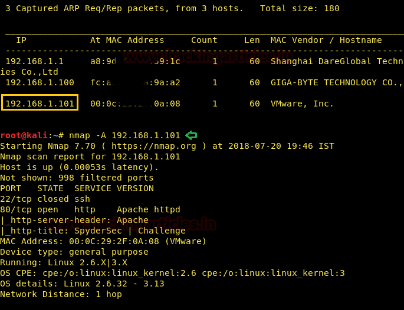
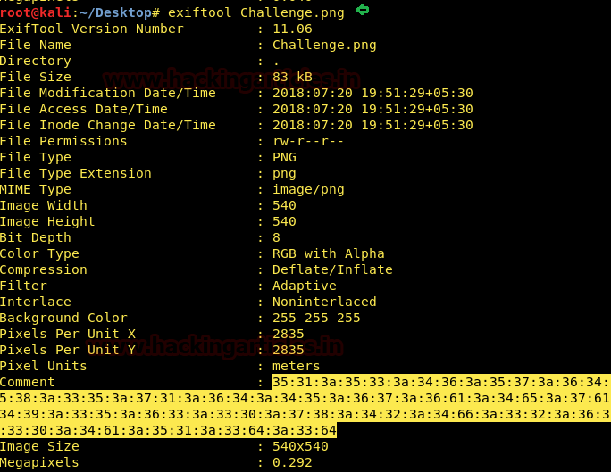
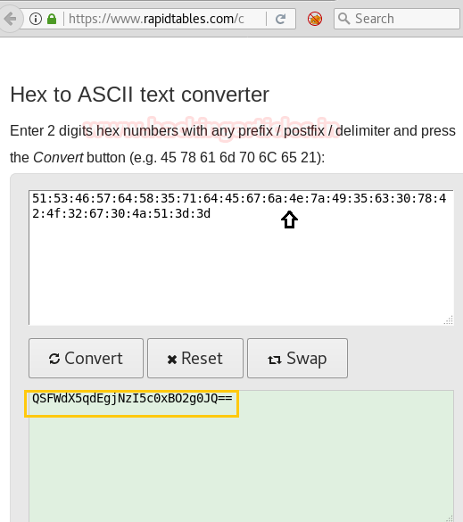
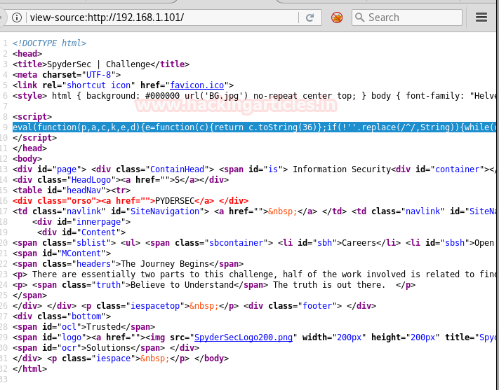
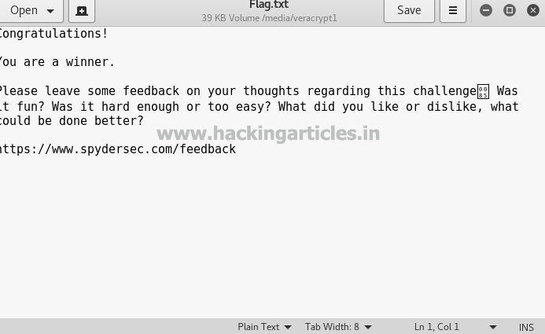

# SpyderSec: Challenge — Writeup

| | |
|-|-|
| **Target IP** | 192.168.1.101 (host-only) |
| **Difficulty** | Intermediate |
| **OS** | Linux |
| **Flags** | 2 (hidden inside TrueCrypt container) |
| **Source** | [VulnHub](https://www.vulnhub.com/entry/spydersec-challenge,128/) |

## Attack Summary

`nmap → EXIF hex→base64 decode → JavaScript eval unpack → TrueCrypt container via tcsteg.py → VeraCrypt mount → flags`

## Methodology

1. Network scan — ports 22 and 80
2. EXIF metadata of `Challenge.png` — hex string decodes to base64 → password/directory hint
3. JavaScript `eval` unpacking from web page → hex → `alert('mulder.fbi')`
4. Burp Suite cookie capture → URL construction → download `mulder.fbi` (TrueCrypt container)
5. `tcsteg.py` reveals hidden volume inside container
6. VeraCrypt mounts hidden volume → flags

---

## Step 1: Network Discovery

```bash
sudo netdiscover -i eth1 -r 192.168.1.0/24
nmap -A 192.168.1.101
```

Open ports: 22 (SSH), 80 (HTTP).



---

## Step 2: EXIF Metadata Analysis

Download `Challenge.png` from the web root and inspect metadata:

```bash
exiftool Challenge.png
# Comment: 4d6f6c646572...  (hex string)
```

Convert hex to ASCII, then base64-decode the result:

```bash
echo "4d6f6c646572..." | xxd -r -p | base64 -d
# Yields a hint/password/directory path
```



---

## Step 3: JavaScript Unpacking

The homepage contains an obfuscated `eval(...)` block. Copy the JS and run it through an unpacker (e.g., `http://jsbeautifier.org/`):

```javascript
// Unpacked output contains another hex string:
// hex → ASCII → alert('mulder.fbi')
```

The target file is `mulder.fbi`.



---

## Step 4: Capture URL and Download Container

Using Burp Suite, intercept a request to the site. The session cookie contains a URL-encoded path. Append `mulder.fbi` to construct the download URL:

```bash
curl -s -o mulder.fbi "http://192.168.1.101/<path>/mulder.fbi"
file mulder.fbi
# TrueCrypt volume
```

---

## Step 5: Hidden Volume Discovery and Mount

Analyze the container for steganographic hidden volume:

```bash
python tcsteg.py mulder.fbi
# Hidden drive detected
```

Open in **VeraCrypt**:
- Select `mulder.fbi` as container
- Choose "Hidden volume" mode
- Enter the password found in Step 2
- Mount → browse contents

```bash
ls /media/veracrypt1/
# flag1.txt  flag2.txt
cat /media/veracrypt1/flag1.txt
cat /media/veracrypt1/flag2.txt
```



---

## Flags

Both flags are inside the hidden VeraCrypt volume. Contents shown only after mounting with the correct password.



---

## Lessons Learned

1. **EXIF metadata** is often overlooked during web app assessments — always run `exiftool` on all downloaded images
2. **JavaScript obfuscation** hides clues; unpackers reveal the underlying logic trivially
3. **TrueCrypt/VeraCrypt hidden volumes** provide plausible deniability — `tcsteg.py` detects them
4. **Cookie-based path enumeration** can expose undocumented download endpoints
5. **Steganography in CTFs** frequently chains multiple layers (hex → base64 → password → container)

## Remediation

| Issue | Fix |
|-------|-----|
| Sensitive data in EXIF metadata | Strip EXIF before publishing images |
| Obfuscated JS hiding internal paths | Minification ≠ security; move secrets server-side |
| Exposed download endpoint in cookie | Validate and authenticate download requests; use signed URLs |
| Sensitive files served from webroot | Keep containers and sensitive files outside the webroot |
